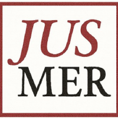
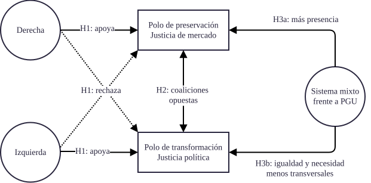
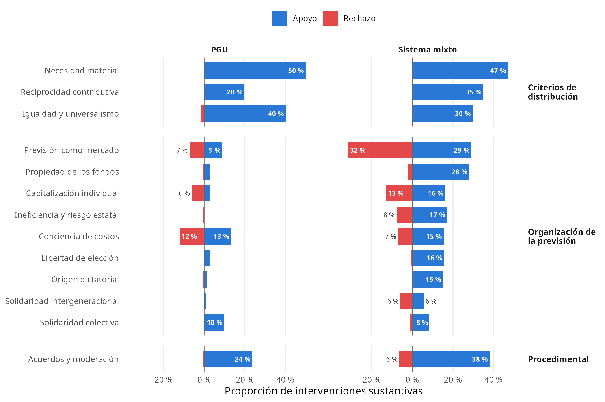
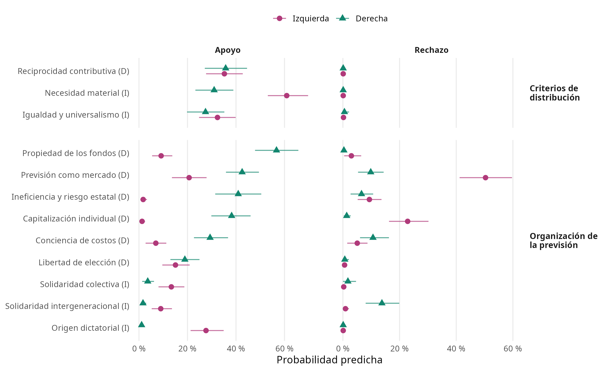
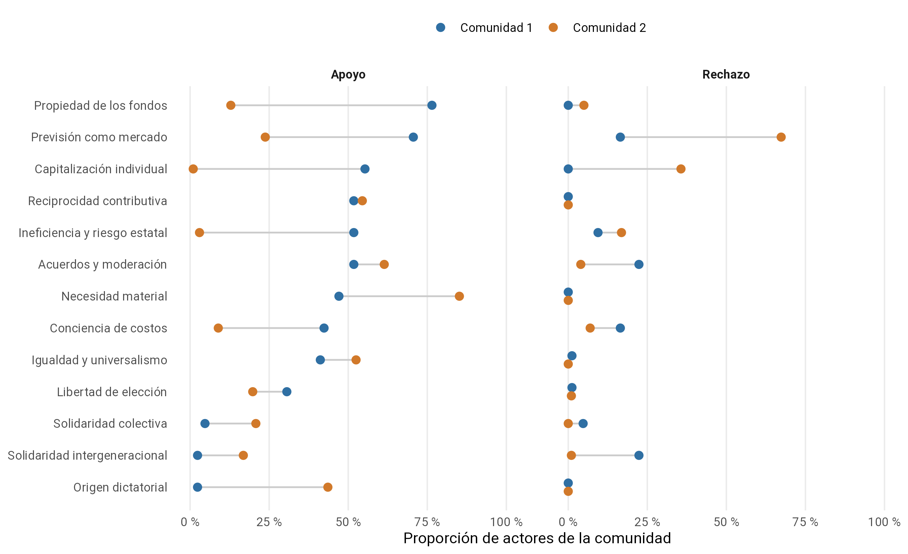
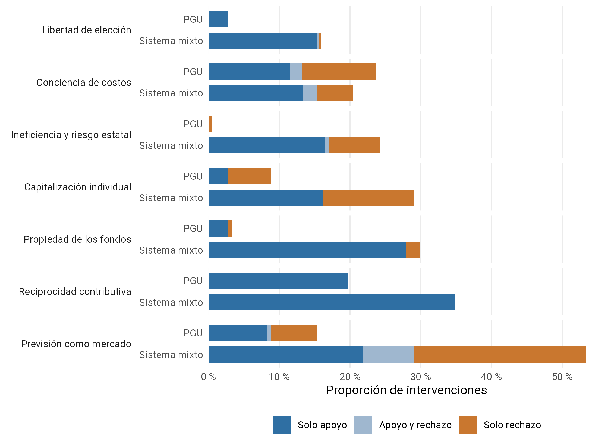
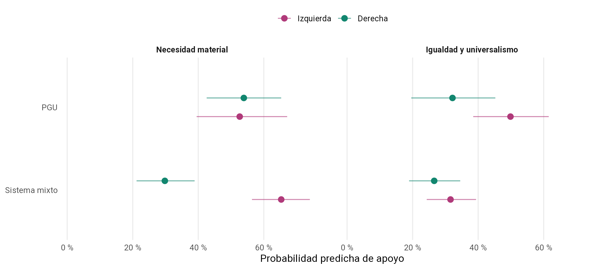
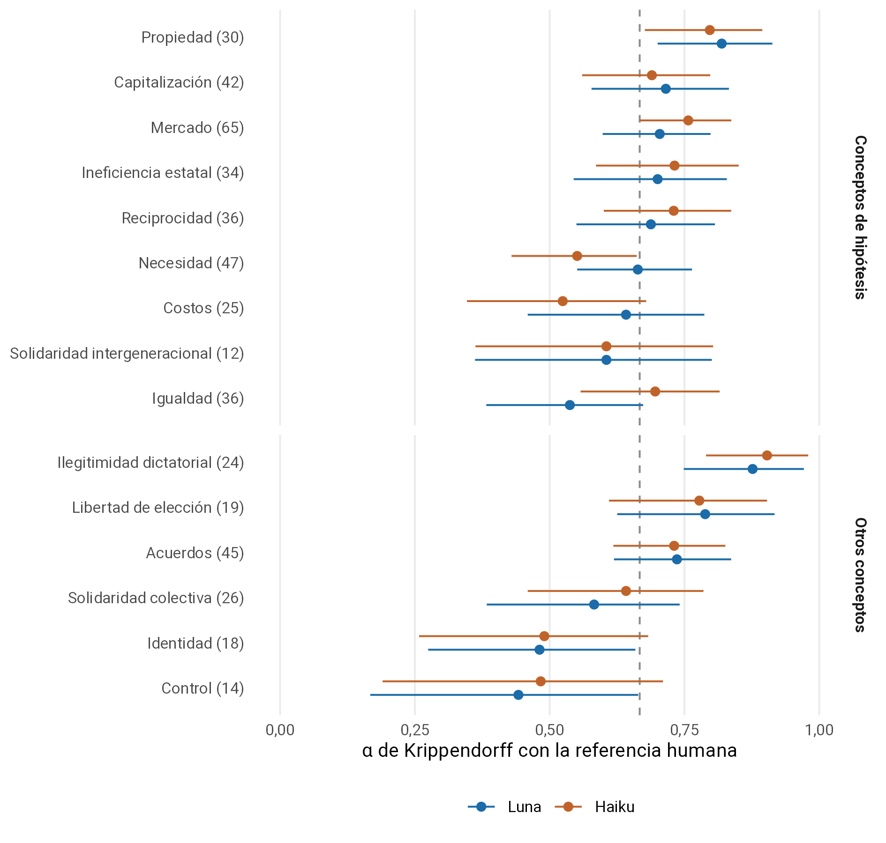
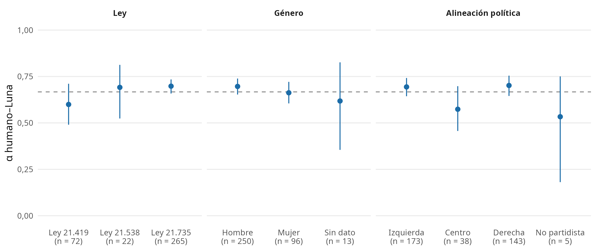
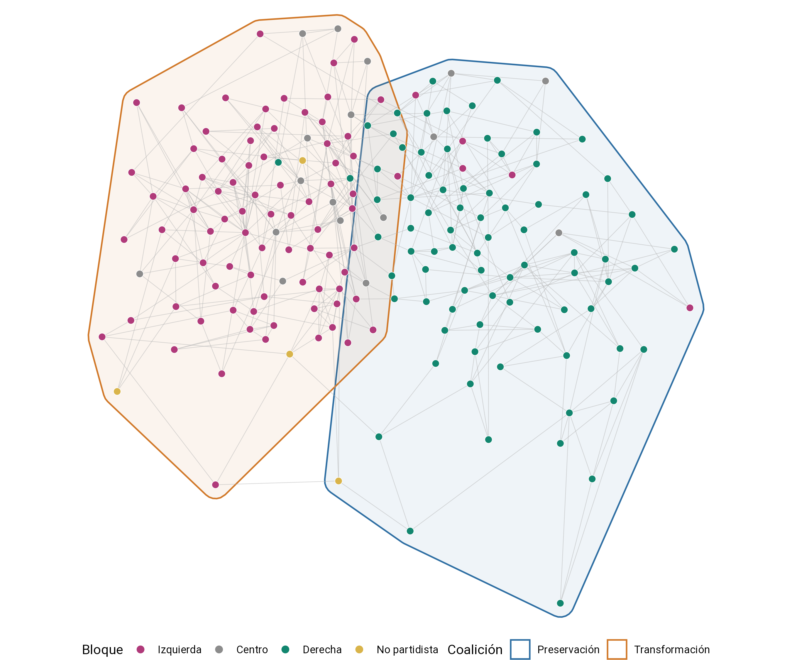

---
# Esqueleto para 20 minutos. Cada lámina tiene una idea en el título y un bloque
# ::: {.notes} con el tiempo y lo que conviene decir (tecla S al presentar).
# Los textos marcados con [COMPLETAR] son para rellenar. Las citas usan las
# claves de Tesis.bib entre corchetes: [@clave; @otra_clave].
# Render: quarto render conferencias/presentacion-tesis.qmd
title: "¿Quién merece y quién administra?"
subtitle: "La economía moral de las pensiones privatizadas en el debate legislativo chileno (2022–2025)"
author: "Ismael Aguayo"
institute: "Profesor guía: Juan Carlos Castillo"
date: 2026-11-26
lang: es
bibliography: ../Tesis.bib
csl: ../apa.csl
format:
  revealjs:
    slide-number: true
    logo: jusmer.png
    embed-resources: true
    width: 1280
    height: 720
    margin: 0.06
    fig-align: center
    theme: [default, jusmer.scss]
---

## Contexto del estudio

:::: {.columns}
::: {.column width="72%"}
- Memoria desarrollada en el marco del proyecto Fondecyt N.º 1250518, *Justicia de mercado y merecimiento del bienestar social* (JUSMER), cuyo investigador responsable es Juan Carlos Castillo.
- Agradecimientos al Centro Nacional de Inteligencia Artificial (CENIA, FB210017, Financiamiento Basal ANID) por el apoyo en créditos de API para la codificación.
:::

::: {.column width="28%"}
{fig-alt="Logo del proyecto JUSMER" width=60%}

{fig-alt="Logo del CENIA" width=95%}
:::
::::

::: {.notes}
**20 segundos.** Pasar rápido: nombrar el proyecto y el agradecimiento, sin
detenerse.
:::

## Introducción

- Las pensiones organizan la distribución de recursos en la vejez y protegen frente a la pobreza [@ebbinghaus_political_2024].
- Las políticas sociales cristalizan concepciones normativas sobre qué distribución del bienestar es legítima [@esping-andersen_three_1990; @liebig_sociology_2016; @sachweh_social_2016].
- Lo mismo ocurre con los mercados: son *economías morales*, arreglos que se sostienen en ideas compartidas sobre qué es justo recibir y por qué [@fourcade_moral_2007b; @koos_moral_2019].
- En pensiones, esas ideas se ordenan en torno a dos polos: la *justicia de mercado*, que recompensa el esfuerzo y la contribución, y la *justicia política*, que protege según la igualdad y la necesidad [@lane_market_1986].

::: {.notes}
**1,5 min.** Una sola idea que avanza: toda forma de distribuir se apoya en una
idea de lo justo.

- Las políticas sociales expresan qué distribución de cargas y beneficios es considerada legítima. 
- Lo mismo ocurre con los mercados, son economías morales, basados en ideas compartidas sobre la justicia.
- Eso se nota sobre todo cuando una reforma cuestiona quién se hace cargo, si el Estado, el mercado o la familia.
- Los dos polos: Justicia de mercado: "cada persona
  debe recibir según lo que ahorró". Justicia política: "toda persona mayor
  debe tener una pensión suficiente, haya cotizado o no".

:::

## El caso chileno: un ejemplo emblemático de privatización

- El caso chileno es esencial para estudiar la justicia de mercado en pensiones.
- Reforma aplicada en dictadura, que reemplaza la solidaridad y el colectivismo por cuentas individuales administradas por privados [@borzutzky_chicago_2005; @mesa-lago_pension_2016; @alemparte_privatizing_2025].
- Contexto de movilizaciones sociales, estallido social, y conflicto sobre la propiedad individual, la solidaridad, el mérito y el rol del Estado [@barozet_fluctuaciones_2025; @rozas-bugueno_challenging_2024; @rozas_entre_2019].
- Tres reformas aprobadas: PGU (2022), ampliación de la PGU (2023) y el sistema mixto (2025).

::: {.notes}
**1 min.**

- Las tres leyes: la PGU (2022) y la ampliación de su cobertura (2023), un
  beneficio no contributivo que no toca las cuentas individuales; y el sistema
  mixto (2025), que disputa el destino de las cotizaciones.
:::

## ¿Qué se ha estudiado en el contexto nacional?

- Diseño institucional y trayectoria política [@borzutzky_chicago_2005; @borzutzky_you_2019; @mesa-lago_pension_2016]
- Resultados financieros y tasa de reemplazo [@larranaga_avances_2024; @benavides_pensiones_2018]
- Las preferencias ciudadanas [@dominguez_sistema_2017; @parada-contzen_evolution_2025]
- Discursos mediáticos en torno a las pensiones [@campos-rojas_apelando_2022; @gonzalezarias_flujo_2020]
- **Actitudes frente a la justicia de mercado y el mérito previsional** [@castillo_deserving_2019; @castillo_perceptions_2025; @castillo_justification_2026]
- No sabemos mucho de cómo estos criterios se articulan en el debate legislativo y cómo se estructura el debate.

::: {.notes}
**1 min.** No leer la lista; agrupar en dos frases.

- Se conoce bien el sistema (diseño, resultados) y lo que piensa la ciudadanía.
- Destacar la línea en negrita: la ciudadanía critica las bajas pensiones y a
  la vez adhiere al mérito contributivo. Esa es la pista que sigue el estudio.
- El vacío: no se sabe cómo esos principios aparecen entre quienes legislan, ni
  cuáles organizan la discusión.
:::

## Pregunta de investigación

- ¿Cómo se articulan las economías morales en disputa en los debates legislativos previsionales chilenos de 2022–2025 y en qué medida el repertorio asociado a la capitalización individual estructura el debate y alcanza a actores reformistas?

::: {.notes}
**30 segundos.** Leer la pregunta y explicar sus dos mitades.

- Primera mitad: qué justificaciones usan los actores y cómo se combinan.
- Segunda mitad: si las justificaciones del sistema vigente fijan los términos
  del debate, incluso para quienes quieren reformarlo.
:::

## Marco conceptual

| Literatura | Concepto central | Qué plantea |
|:--|:--|:--|
| **Merecimiento** | Juicios sobre quién debe recibir protección y bajo qué condiciones: control, actitud, reciprocidad, identidad y necesidad [@vanoorschot_who_2000]. Igualdad y universalismo, consciencia de costos @laenen_why_2019. | Los adultos mayores se consideran merecedores [@vanoorschot_making_2006; @meuleman_welfare_2020]. La derecha privilegia la reciprocidad, y la izquierda, la necesidad [@reeskens_equity_2013]; en Chile, el mérito contributivo es transversal [@castillo_deserving_2019]. |
| **Ideas y estructuración discursiva** | *Ideas normativas*: justifican por qué una política es legítima [@schmidt_discursive_2008]. *Estructuración*: un discurso fija las premisas que los demás deben reconocer [@hajer_discourse_1997]. | Los actores forman coaliciones discursivas en torno a líneas argumentales, y algunas ideas operan como imanes de coalición [@beland_ideas_2016]. |
| **Pensiones privatizadas en Chile** | Justificaciones sobre la organización del sistema: de quién son los fondos, quién los administra y con qué límites. | *Defensa:* propiedad de los fondos, libertad de elección, mercado, riesgo estatal y restricción de gasto [@borzutzky_chicago_2005; @alemparte_privatizing_2025; @kay_can_2022; @castiglioni_explaining_2018]. *Crítica:* necesidad, solidaridad y origen dictatorial [@rozas_entre_2019; @rozas-bugueno_challenging_2024; @lopez-gonzalez_memorias_2025]. |

: {tbl-colwidths="[17,38,45]"}

::: {.notes}
**2 min.** 

- Las tres dicen qué criterios existen, y qué se ha disputado
concretamente en un sistema privatizado.
- Dejar planteada la tensión: la literatura europea espera que la
  reciprocidad divida a los bloques; la evidencia chilena sugiere lo contrario.
- Estructuración: ejemplo del parlamentario que impulsa un fondo solidario y
  asegura que respeta la propiedad de los fondos.
- Pensiones privatizadas en Chile: entrar diciendo que el merecimiento no agota
  lo que se discute. Quien defiende o critica el sistema también argumenta
  sobre cómo se organiza.
- Cierre: con estas tres literaturas se arma la tabla siguiente.
:::

## Los conceptos por tipo de justificación y polo esperado

|  | **Polo de preservación**<br>*Justicia de mercado* | **Polo de transformación**<br>*Justicia política* |
|:--|:--|:--|
| **Criterios de distribución**<br>*¿Quién merece?* | Reciprocidad contributiva | Necesidad material<br>Igualdad y universalismo |
| **Organización de la previsión**<br>*¿Quién administra?* | Propiedad de los fondos<br>Capitalización individual<br>Libertad de elección<br>Previsión como mercado<br>Ineficiencia y riesgo estatal<br>Conciencia de costos | Solidaridad intergeneracional<br>Solidaridad como deber colectivo<br>Ilegitimidad del origen dictatorial |

: {tbl-colwidths="[26,37,37]"}

::: {.notes}
**1,5 min.** 

- La columna de preservación completa es el **repertorio de mercado**: siete
  conceptos, uno distributivo (reciprocidad) y seis de organización.
- Anticipar: las hipótesis preguntan si los actores se ordenan según las
  columnas en ambas filas, o solo en una.
:::

## Hipótesis

{width=78%}

::: {.notes}
**45 segundos.** Recorrer el diagrama de izquierda a derecha.

- H1a: los bloques se diferencian en los criterios de distribución.
- H1b: los bloques se diferencian en la organización de la previsión.
- H2: dos coaliciones discursivas, preservación y transformación.
- H3a: el repertorio de mercado aparece más en el sistema mixto que en la PGU.
- H3b: necesidad e igualdad son más transversales en la PGU.
Mencionar las expectativas rivales sobre la reciprocidad: la literatura europea
espera que divida a los bloques; la evidencia chilena sugiere que es transversal.
:::

## Datos y método

:::: {.columns}
::: {.column width="56%"}
1. **Corpus:** 9 discusiones en Sala de tres leyes, con 1.096 intervenciones.
2. **Cada intervención se descompone en declaraciones:** un actor apoya o rechaza un concepto [@leifeld_discourse_2017]. La codificación se hizo con un modelo de lenguaje y se validó a ciegas (α = 0,68).
3. **Con esas declaraciones se responde cada hipótesis:**
   - los actores que coinciden se agrupan en comunidades (H2);
   - modelos logísticos multinivel entregan la probabilidad de que cada bloque apoye o rechace cada concepto (H1 y H3b);
   - la proporción de intervenciones que mencionan cada concepto se compara entre debates (H3a).
:::

::: {.column width="44%"}
```{=html}
<svg viewBox="0 0 470 320" xmlns="http://www.w3.org/2000/svg" role="img" aria-label="Dos actores vinculados a dos conceptos por declaraciones de apoyo o rechazo" style="width:100%; height:auto; font-family:'Noto Serif', Georgia, serif;">
  <defs>
    <marker id="dna-flecha" viewBox="0 0 10 10" refX="9" refY="5" markerWidth="7" markerHeight="7" orient="auto-start-reverse">
      <path d="M 0 0 L 10 5 L 0 10 z" fill="#92220C"/>
    </marker>
  </defs>
  <text x="85" y="22" text-anchor="middle" font-size="15" fill="#92220C" font-weight="bold">Actores</text>
  <text x="375" y="22" text-anchor="middle" font-size="15" fill="#92220C" font-weight="bold">Conceptos</text>
  <line x1="150" y1="88" x2="288" y2="88" stroke="#92220C" stroke-width="2.2" marker-end="url(#dna-flecha)"/>
  <line x1="150" y1="212" x2="288" y2="100" stroke="#92220C" stroke-width="2.2" marker-end="url(#dna-flecha)"/>
  <line x1="150" y1="100" x2="288" y2="212" stroke="#92220C" stroke-width="2.2" marker-end="url(#dna-flecha)"/>
  <line x1="150" y1="224" x2="288" y2="224" stroke="#92220C" stroke-width="2.2" stroke-dasharray="7 6" marker-end="url(#dna-flecha)"/>
  <ellipse cx="85" cy="94" rx="68" ry="36" fill="#f2d9d9" stroke="#92220C" stroke-width="2"/>
  <text x="85" y="90" text-anchor="middle" font-size="16" fill="#272828">Actor 1</text>
  <text x="85" y="110" text-anchor="middle" font-size="14" fill="#272828" font-style="italic">izquierda</text>
  <ellipse cx="85" cy="218" rx="68" ry="36" fill="#f2d9d9" stroke="#92220C" stroke-width="2"/>
  <text x="85" y="214" text-anchor="middle" font-size="16" fill="#272828">Actor 2</text>
  <text x="85" y="234" text-anchor="middle" font-size="14" fill="#272828" font-style="italic">derecha</text>
  <rect x="292" y="60" width="166" height="68" rx="4" fill="#ffffff" stroke="#272828" stroke-width="2"/>
  <text x="375" y="90" text-anchor="middle" font-size="16" fill="#272828">Propiedad de</text>
  <text x="375" y="110" text-anchor="middle" font-size="16" fill="#272828">los fondos</text>
  <rect x="292" y="184" width="166" height="68" rx="4" fill="#ffffff" stroke="#272828" stroke-width="2"/>
  <text x="375" y="214" text-anchor="middle" font-size="16" fill="#272828">Solidaridad</text>
  <text x="375" y="234" text-anchor="middle" font-size="16" fill="#272828">intergeneracional</text>
  <line x1="110" y1="296" x2="160" y2="296" stroke="#92220C" stroke-width="2.2"/>
  <text x="168" y="301" font-size="14" fill="#272828">apoya</text>
  <line x1="250" y1="296" x2="300" y2="296" stroke="#92220C" stroke-width="2.2" stroke-dasharray="7 6"/>
  <text x="308" y="301" font-size="14" fill="#272828">rechaza</text>
</svg>
```
:::
::::

::: {.notes}
**1,5 min.** Contarlo como un recorrido: tengo este corpus, así se codifica, y
eso permite dos tipos de análisis.

- El diagrama es la unidad del análisis de redes discursivas: actor, postura y
  concepto. Dos actores quedan vinculados positivamente cuando coinciden en un
  concepto (aquí, la propiedad de los fondos) y negativamente cuando se oponen
  (aquí, la solidaridad intergeneracional).
- De ahí salen las dos familias de análisis. Las comunidades agrupan a los
  actores más parecidos sin usar su partido. Los modelos comparan a derecha e
  izquierda concepto por concepto.
- Limitación que hay que decir: un solo codificador humano, así que la
  validación mide acuerdo con una referencia y no exactitud.

**Por si preguntan** (el detalle está en los anexos):

- Por qué GPT-6 Luna: ambos modelos concuerdan igual con la referencia (α = 0,68
  y 0,69), pero Luna concuerda mejor en necesidad material (0,66 frente a 0,55),
  que con Haiku habría quedado excluida. El segundo modelo sirvió para señalar
  errores de postura: 60 casos adjudicados a ciegas, 40 cambiaron.
- Conceptos eliminados: control (α = 0,44) e identidad (α = 0,48), porque todo
  su intervalo queda bajo 0,667. Actitud tiene solo dos declaraciones.
- Modelos: binarios, uno para el apoyo y otro para el rechazo, porque una
  intervención puede hacer ambas cosas. El término concepto × bloque es
  aleatorio porque hay celdas sin casos.
- Intervalos: remuestreo de actores, 1.000 réplicas; en cada una se sortean
  actores con reposición dentro de cada bloque, se reajusta el modelo y se
  recalculan las predicciones y sus diferencias.
- Comunidades: *signed spin-glass* sobre una red con signo
  [@traag_community_2009]; distingue a dos actores que se oponen de dos que
  simplemente no comparten conceptos. 50 semillas, dos comunidades en todas.
:::

## Qué se disputa

{width=80%}

::: {.notes}
**1,5 min.** Tres ideas, no más:

1. La necesidad material es el concepto más apoyado en ambos debates.
2. Todo el rechazo recae en la organización de la previsión: de los 247
   rechazos del sistema mixto, solo uno recae en un criterio de distribución.
3. La propiedad de los fondos y la libertad de elección casi no se rechazan.
:::

## H1 · Bloques políticos: ¿la derecha y la izquierda justifican distinto?
{width=82%}

::: {.notes}
**2 min.**

- H1a se sostiene solo para la necesidad (61 % en la izquierda, 31 % en la derecha).
  La reciprocidad es igual en ambos bloques (36 % y 35 %).
- H1b se sostiene en ocho de nueve conceptos. La mayor diferencia es la
  propiedad de los fondos (57 % frente a 9 %).
- La excepción es la libertad de elección: la izquierda no discute el valor de
  elegir, sino qué arreglo lo garantiza.
Explicar (D) e (I): el bloque que la hipótesis esperaba que apoyara más.
:::

## H2 · Coaliciones: ¿se agrupan los actores en dos coaliciones?
{width=80%}

::: {.notes}
**1,25 min.**

- Se sostiene parcialmente. El algoritmo encuentra dos comunidades en las 50
  ejecuciones: 85 actores, 73 de derecha; y 101, con 79 de izquierda y 13 de
  centro. La red está en los anexos.
- La coalición de preservación es la esperada, salvo en la reciprocidad, que
  apoyan por igual ambas (52 % y 54 %).
- La de transformación no se define por la igualdad ni por la solidaridad
  intergeneracional, sino por la necesidad (85 %), el origen dictatorial (44 %)
  y el rechazo a la previsión como mercado (67 %).
- Se parece más al repertorio de NO+AFP que a un proyecto universalista.
:::

## H3a · Presencia: ¿aparece más el repertorio de mercado en el sistema mixto?
:::: {.columns}
::: {.column width="55%"}

:::

::: {.column width="45%"}
> «Tienen razón, porque es mejor tener la plata ahí, aunque sea poca, pero es de ellos. Pues bien, esta reforma no toca esa cuenta individual ni ahora ni en el futuro.»

Diputada, Convergencia Social
:::
::::

::: {.notes}
**1 min.**

- Seis de los siete conceptos aparecen más en el sistema mixto que en la PGU,
  con aumentos de entre 13 y 38 puntos. La excepción es la conciencia de costos.
- El repertorio también aparece para ser rechazado: la previsión como mercado
  tiene tantos rechazos como apoyos.
- La cita muestra la estructuración: una diputada oficialista concede la
  premisa de la propiedad para defender la reforma.
:::

## H3b · Transversalidad: ¿comparten los bloques la necesidad y la igualdad en la PGU?
{width=85%}

::: {.notes}
**45 segundos.**

- Se sostiene parcialmente:
- Necesidad material: en la PGU la apoyan por igual izquierda y derecha (53 % y
  54 %); en el sistema mixto, la izquierda el doble (65 % y 30 %).
- Igualdad: al contrario de lo esperado, distingue a los bloques en la PGU y no
  en el sistema mixto, aunque el cambio entre debates no es concluyente.
- Lectura: un mismo criterio justifica políticas distintas. En la PGU, un
  beneficio focalizado que no toca las cuentas individuales.
:::

## Discusión: qué pasó con las hipótesis

| Hipótesis | Resultado |
|:--|:--|
| **H1a** Criterios de distribución | Solo la necesidad distingue a los bloques; la reciprocidad es compartida. |
| **H1b** Organización de la previsión | Se sostiene en ocho de nueve conceptos. |
| **H2** Coaliciones | Dos coaliciones estables; la de transformación se define por la necesidad y el rechazo al mercado. |
| **H3a** Presencia del repertorio | Se sostiene en seis de siete conceptos. |
| **H3b** Transversalidad | Solo para la necesidad material. |

: {tbl-colwidths="[36,64]"}

::: {.notes}
**45 segundos.** Recorrer rápido; el patrón común es que lo esperado se cumple
en la organización de la previsión y no en los criterios de distribución.
:::

## Se comparte quién merece; se disputa cómo se organiza la previsión

- **Nadie rechaza la necesidad ni la reciprocidad.** Todo el rechazo del debate recae en la organización del sistema. Consistente con la literatura nacional @castillo_deserving_2019.
- **Los mismos criterios sustentan diseños opuestos.** La reciprocidad defiende las cuentas individuales en la derecha y la retribución a quienes cotizaron y cuidaron en la izquierda; la necesidad justifica un beneficio focalizado o un seguro social.
- **Lo que separa a la justicia de mercado de la justicia política** [@lane_market_1986] son justificaciones institucionales: de quién son los fondos, quién los administra y cuánto se confía en el Estado y en el mercado.
- **El marco de merecimiento discrimina poco las posiciones de las élites legislativas** sobre las pensiones [@laenen_why_2019].

::: {.notes}
**1,5 min.** Es la contribución principal; decirla con calma.

- La literatura de merecimiento esperaba que la derecha se apoyara en la
  reciprocidad y la izquierda en la necesidad. La reciprocidad resulta
  compartida, como sugería la evidencia actitudinal chilena
  [@castillo_deserving_2019].
- Consecuencia: para entender el conflicto previsional no basta preguntar quién
  merece. Hay que mirar las justificaciones propias de cada arreglo
  institucional.
:::

## El repertorio de mercado fija los términos del debate

- **La izquierda rechaza el mercado, pero no la propiedad de los fondos ni la libertad de elegir:** las reclama para su reforma. Las premisas del sistema vigente se vuelven una condición para ser creíble [@hajer_discourse_1997].

> «No nos dejemos engañar por la derecha: los ahorros se mantendrán como propiedad individual y no serán expropiados.»
>
> Diputada, Partido Ecologista Verde

- **La propiedad de los fondos opera como imán de coalición** [@beland_ideas_2016], reforzada tras los retiros de fondos [@kay_can_2022].
- **La coalición de transformación se define por la necesidad, el origen dictatorial y el rechazo al mercado:** está más cerca del repertorio de NO+AFP que de un proyecto universalista [@rozas_entre_2019].

::: {.notes}
**1,25 min.** Aquí está la respuesta a la segunda mitad de la pregunta.

- La cita: una diputada que apoya la reforma la defiende en los términos de
  quienes se oponen a ella. No discute que los ahorros deban ser propiedad
  individual; asegura que lo seguirán siendo.
- Se suma a la de la diputada de Convergencia Social, que concede que "es mejor
  tener la plata ahí" y asegura que la reforma no toca la cuenta individual.
- Otra variante, por si sirve: la izquierda usa la propiedad contra las AFP.
  "Los ahorros son de las y los trabajadores, no son de las AFP" (diputado,
  Revolución Democrática).
- La reforma se defiende mostrando que respeta las premisas del sistema que
  busca cambiar. Eso es estructuración discursiva.
- La coalición de transformación comparte un diagnóstico y un adversario más
  que un diseño alternativo: la solidaridad intergeneracional la apoya menos de
  uno de cada cinco de sus actores.
- La necesidad es compartida mientras no cuestiona la organización del sistema,
  como en la PGU y antes en el Pilar Solidario.
:::

## Lectura alternativa y alcance

- **¿Consenso normativo o costo político?** La Sala es un espacio de legitimación ante el público [@schmidt_discursive_2008], donde es difícil negar que una persona mayor merece una pensión digna. La disputa sobre los criterios podría darse en las comisiones, que no se observan.
- **Alcance del análisis de merecimiento:** se limita a la necesidad y la reciprocidad; el control y la identidad no pudieron medirse con confianza.
- **Diseño descriptivo:** no se estima el efecto de estos discursos sobre el resultado legislativo.
- **Validación con un solo codificador humano.**

::: {.notes}
**1 min.** Cerrar con honestidad sobre lo que el diseño permite afirmar, y
abrir a comentarios.

- El diseño no permite distinguir entre consenso normativo y costo político;
  ambas lecturas son compatibles con los datos.
- Próximos pasos: comisiones y prensa, otros países, y la relación entre los
  discursos y los cambios efectivos en la ley.
:::

## Referencias {.scrollable .smaller}

::: {#refs}
:::

# Anexos {visibility="uncounted"}

## Validación de la codificación {visibility="uncounted"}

- Concordancia global: GPT-6 Luna α = 0,68; Claude Haiku 5.5 α = 0,69.
- Cuando coinciden en el concepto, coinciden en la postura en el 98 % de los casos.
- Excluidos: control (α = 0,44) e identidad (α = 0,48).
- Igualdad y universalismo se mantiene cerca del umbral (α = 0,54).
- Sin diferencias entre izquierda y derecha ni entre hombres y mujeres.

## Concordancia por concepto {visibility="uncounted"}

{width=78%}

## Concordancia por debate, género y alineación {visibility="uncounted"}

{width=78%}

## Red de actores y comunidades detectadas {visibility="uncounted"}

{width=62%}

## Especificación de los modelos {visibility="uncounted" .smaller}

**H1.** Una observación por intervención y concepto (351 intervenciones × 12 conceptos). Un modelo para el apoyo y otro para el rechazo:

logit(*p*) = β₀ + β₁ · centro + β₂ · derecha + β₃ · mujer + β₄ · log(palabras) + *u*(actor) + *v*(concepto) + *w*(concepto × bloque)

- *u*, *v* y *w* son interceptos aleatorios. El término concepto × bloque contrasta la hipótesis; es aleatorio porque hay combinaciones sin casos.
- Probabilidad predicha: promedio sobre todas las intervenciones, asignadas a cada bloque, sin el efecto del actor.

**H3a.** Presencia de un concepto: proporción de intervenciones sustantivas que lo mencionan, con apoyo o con rechazo. Se compara entre los debates de la PGU (182 intervenciones) y el del sistema mixto (358). Se usa la presencia y no solo el apoyo porque un repertorio estructura el debate cuando los demás deben argumentar en sus términos, incluso para oponerse.

**H3b.** Un modelo por concepto, con bloque, debate y su interacción, género, longitud e intercepto aleatorio por actor.

**Intervalos.** 1.000 réplicas en que se sortean actores con reposición (dentro de cada bloque en los modelos, dentro de cada debate en H3a) y se recalculan las estimaciones; percentiles 2,5 y 97,5.

**H2.** Vínculo entre actores: congruencia menos conflicto, normalizados por similitud de coseno. *Signed spin-glass* con 50 semillas, máximo de 10 comunidades y resolución por defecto.

## Composición y estabilidad de las comunidades {visibility="uncounted" .smaller}

| Comunidad | Actores | Izquierda | Centro | Derecha | No partidista | Coasignación |
|:--|:-:|:-:|:-:|:-:|:-:|:-:|
| Preservación | 85 | 8 % | 5 % | 86 % | 1 % | 0,98 |
| Transformación | 101 | 78 % | 13 % | 6 % | 3 % | 1,00 |

Partición de mayor modularidad entre 50 ejecuciones de *signed spin-glass*. Coasignación: proporción media de ejecuciones en que dos actores de la comunidad quedan juntos.

## Presencia del repertorio de mercado (H3a) {visibility="uncounted" .smaller}

| Concepto | PGU | Sistema mixto | Δ (pp) |
|:--|:-:|:-:|:-:|
| Previsión como mercado | 15,4 | 53,4 | 38,0 [29,9; 45,6] |
| Propiedad de los fondos | 3,3 | 29,9 | 26,6 [20,6; 32,6] |
| Ineficiencia y riesgo estatal | 0,5 | 24,3 | 23,8 [19,0; 28,7] |
| Capitalización individual | 8,8 | 29,1 | 20,3 [14,0; 26,8] |
| Reciprocidad contributiva | 19,8 | 34,9 | 15,1 [7,3; 22,9] |
| Libertad de elección | 2,7 | 15,9 | 13,2 [8,5; 17,9] |
| Conciencia de costos | 23,6 | 20,4 | −3,2 [−11,0; 4,7] |

Porcentaje de intervenciones sustantivas que mencionan el concepto. Intervalos de confianza del 95 % por remuestreo de actores.
