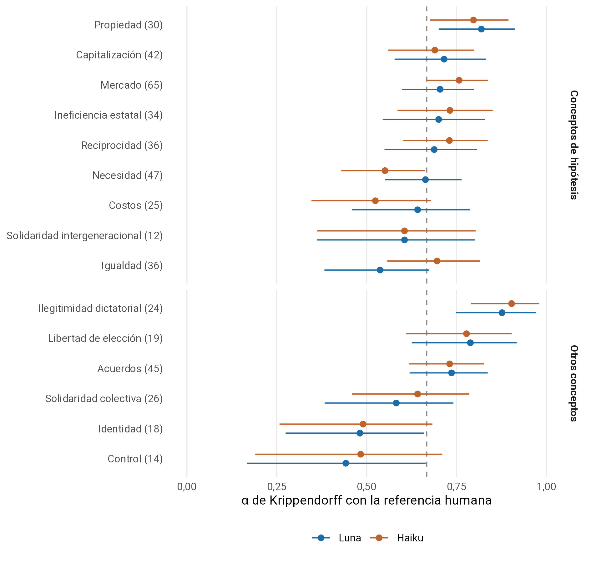
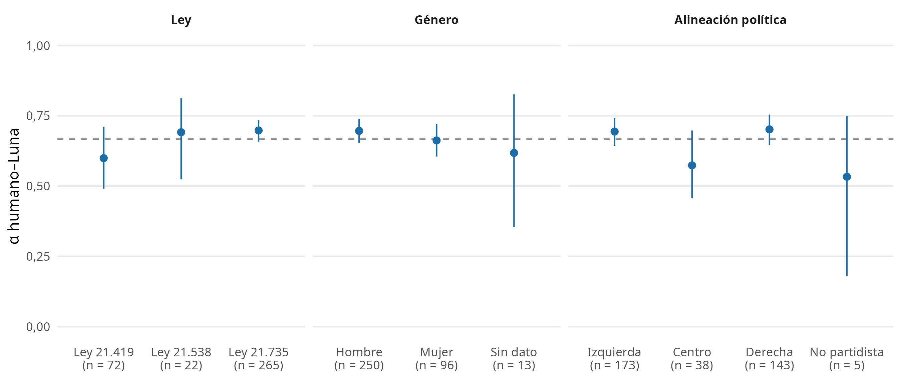
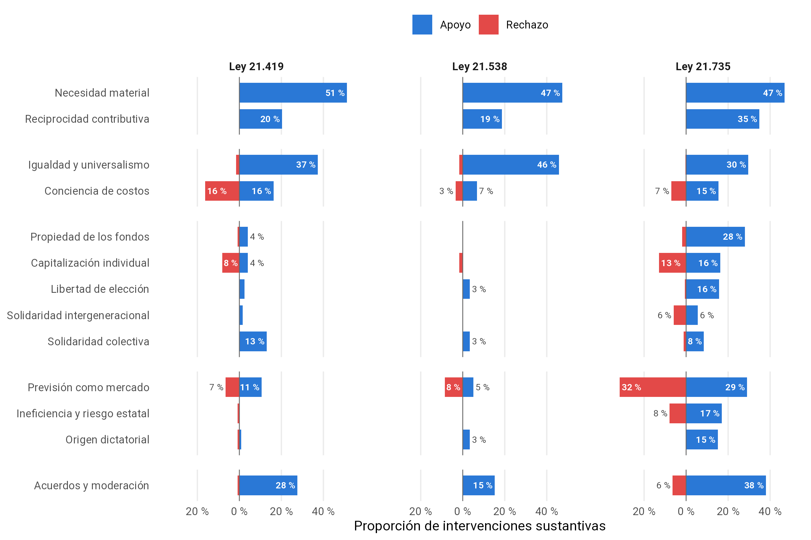
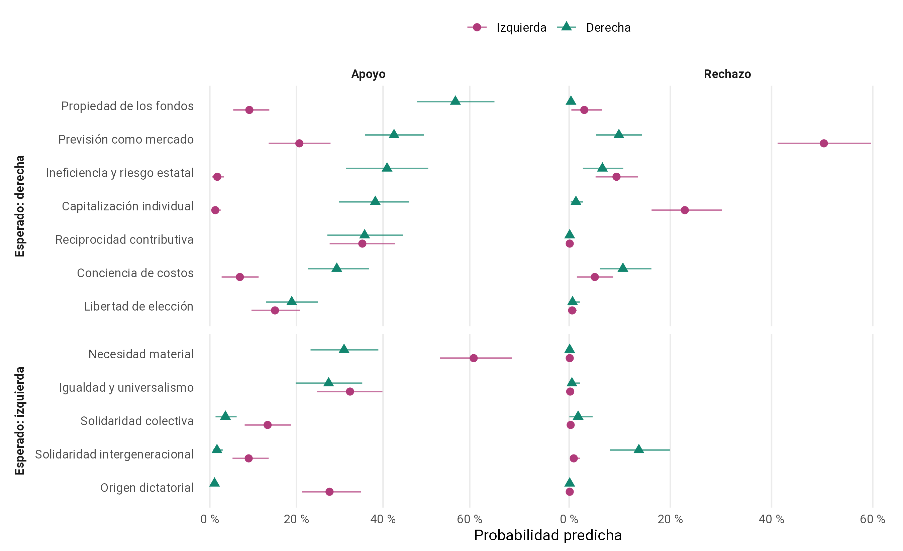

**UNIVERSIDAD DE CHILE**\
**FACULTAD DE CIENCIAS SOCIALES**\
**DEPARTAMENTO DE SOCIOLOGIA**

**Título: Robustez ideacional de la capitalización individual: coaliciones discursivas de justicia social en el debate previsional chileno**

**Tesis para optar al Título de Sociología**

**Autor Ismael Aguayo**\
**Profesor guía Juan Carlos Castillo**

**Santiago de Chile, año 2026**

Memoria desarrollada en el marco del proyecto de Fondecyt Nº 1250518 y el Centro Nacional de Inteligencia Artificial CENIA FB210017, Financiamiento Basal ANID

## **Declaración de uso de Inteligencia Artificial** {#declaración-de-uso-de-inteligencia-artificial}

En la elaboración de esta tesis se utilizaron las siguientes herramientas de inteligencia artificial generativa: Claude Code, Codex, modelos a través de las APIs de OpenAI y Amazon Bedrock, y Grammarly. Claude Code y Codex se utilizaron para apoyar la generación de código para el procesamiento y análisis de datos, así como para el desarrollo de una aplicación web para la validación de datos. Todo el código fue validado mediante múltiples pruebas automatizadas y los repositorios están disponibles para su revisión en Github. Grammarly se utilizó para apoyar la redacción, la gramática y la ortografía en todas las secciones de la tesis. Los servicios en la nube de OpenAI y Amazon Bedrock se utilizaron para generar codificaciones, que fueron validadas manualmente y contrastadas con las codificaciones del investigador. Este último paso se describe en detalle en la metodología y se adjunta el prompt empleado en el Anexo 2. Todo el contenido fue revisado y validado por el autor, quien asume plena responsabilidad sobre el trabajo presentado.

[**Declaración de uso de Inteligencia Artificial 3**](#declaración-de-uso-de-inteligencia-artificial)

[**Abstract 5**](#abstract)

[**Introducción 6**](#introducción)

[**1. La dimensión moral y normativa en el debate previsional 8**](#1.-la-dimensión-moral-y-normativa-en-el-debate-previsional)

[1.1. Justicia de mercado vs. Justicia política: Los mercados como economías morales 8](#1.1.-justicia-de-mercado-vs.-justicia-política:-los-mercados-como-economías-morales)

[1.2. La condicionalidad de la seguridad social en la vejez 10](#1.2.-la-condicionalidad-de-la-seguridad-social-en-la-vejez)

[**2. Persistencia ideacional y estructuración discursiva 12**](#2.-persistencia-ideacional-y-estructuración-discursiva)

[2.1. Persistencia ideacional y el rol de las ideas 12](#2.1.-persistencia-ideacional-y-el-rol-de-las-ideas)

[2.2 Las coaliciones discursivas y la hegemonía 13](#2.2-las-coaliciones-discursivas-y-la-hegemonía)

[**3. El debate previsional chileno: polos discursivos y actores mediadores 14**](#3.-el-debate-previsional-chileno:-polos-discursivos-y-actores-mediadores)

[**4. Metodología 18**](#4.-metodología)

[4.1 Datos 18](#4.1-datos)

[4.2 Variables 20](#4.2-variables)

[4.3 Estrategia de análisis 21](#4.3-estrategia-de-análisis)

[4.3.1 Estrategia de codificación y validación 21](#4.3.1-estrategia-de-codificación-y-validación)

[4.3.2 Análisis descriptivo y modelamiento de patrones discursivos 22](#4.3.2-análisis-descriptivo-y-modelamiento-de-patrones-discursivos)

[**5. Resultados 25**](#5.-resultados)

[5.1 Validación codificación asistida por LLM 25](#5.1-validación-codificación-asistida-por-llm)

[**Referencias 27**](#referencias)

[**8. Material Suplementario 40**](#8.-material-suplementario)

[8.1 Anexo 1: Libro de códigos 40](#8.1-anexo-1:-libro-de-códigos)

[codebook_v5.xlsm 40](#codebook_v5.xlsm)

[8.2 Anexo 2: Prompt utilizado 40](#8.2-anexo-2:-prompt-utilizado)

## **Abstract** {#abstract}

El sistema chileno de pensiones de capitalización individual ha persistido pese a crisis de legitimidad, alta conflictividad social y sucesivos intentos de reforma estructural. Esta investigación analiza las economías morales en disputa en el debate legislativo previsional chileno y examina en qué medida el repertorio asociado a la capitalización individual mantiene su centralidad y alcanza a actores reformistas. Se comparan tres procesos: la creación de la Pensión Garantizada Universal (PGU), Ley N.º 21.419; la ampliación de su universo de focalización, Ley N.º 21.538; y la reforma previsional, Ley N.º 21.735. Esta última constituye el caso principal para estudiar la persistencia y difusión del repertorio durante las discusiones en Sala de 2024 y 2025. Se espera encontrar dos polos discursivos vinculados con la justicia de mercado y la justicia política, junto con posiciones de intermediación de actores de centroizquierda. El primero articularía la propiedad y la capitalización individual con la reciprocidad contributiva, las restricciones de gasto y las justificaciones de la organización privada y mercantil de la previsión; el segundo, la igualdad o el universalismo con la solidaridad intergeneracional. Se espera que la necesidad material actúe como puente entre los repertorios de ambos polos. Las hipótesis comparan la centralidad de estos conceptos entre proyectos y examinan la persistencia del repertorio de capitalización individual. Metodológicamente, el estudio aplica análisis de redes discursivas (DNA) a nueve discusiones en Sala de la Cámara de Diputadas y Diputados y del Senado, que reúnen 1.096 intervenciones elegibles, segmentadas en 3.609 fragmentos. Se combina codificación asistida por grandes modelos de lenguaje y validación manual con análisis de frecuencias, cobertura de actores, redes y modelos logísticos con intercepto por actor. La lectura dirigida de argumentos permite interpretar conjuntamente estos resultados como evidencia sobre la estructuración del debate. Con ello, la investigación busca aportar evidencia sobre el rol de las ideas y la justicia social en la estructuración del debate previsional chileno.

**Palabras clave:** economías morales; capitalización individual; coaliciones discursivas; justicia social; análisis de redes discursivas.

## **Introducción** {#introducción}

Los sistemas de pensiones constituyen una de las instituciones de protección social más determinantes en el ciclo de vida, al organizar la distribución de recursos en la vejez y al proteger a las personas frente a dificultades económicas (Ebbinghaus & Wiß, 2024). Desde la sociología de la justicia, las políticas sociales cristalizan concepciones normativas sobre qué se considera una distribución legítima del bienestar, y esas concepciones se vuelven especialmente visibles cuando una reforma cuestiona el equilibrio entre Estado, mercado y familia (Esping-Andersen, 1990; Liebig & Sauer, 2016; Sachweh, 2016). En el caso de las pensiones, esta disputa puede organizarse en torno a la tensión entre la *justicia de mercado*, que legitima la asignación de beneficios según el esfuerzo, la contribución y la responsabilidad individual, y la *justicia política*, que enfatiza la igualdad, la necesidad y la intervención colectiva frente a los riesgos sociales (Lane, 1986). Esta investigación analiza la estructuración discursiva de los debates legislativos previsionales chilenos de 2022–2025, entendidos como arenas en las que distintos actores movilizan concepciones de justicia social y criterios de merecimiento para defender, reformar o disputar la capitalización individual.

Chile resulta un caso emblemático para examinar esta disputa normativa. A partir de la reforma de 1981, su sistema previsional se organizó en torno a cuentas individuales administradas por privados. Este esquema desplazó los principios de colectivismo y solidaridad, confvirtiéndose en un ejemplo paradigmático de privatización y comodificación del bienestar (Alemparte, 2025; Borzutzky, 2005; Mesa-Lago & Bertranou, 2016). Históricamente, este diseño ha sido cuestionado por sus bajas pensiones, desigualdades de género y de clase, persistiendo institucionalmente pese a la alta conflictividad social y a sucesivos intentos de reforma (Borzutzky, 2019; Larrañaga, 2024; Rozas & Maillet, 2019). En los últimos años, el estallido social de 2019, los retiros de fondos previsionales durante la pandemia y la discusión constitucional reactivaron el conflicto sobre la propiedad individual, la solidaridad, el mérito y el rol del Estado, desplazando el debate previsional hacia una disputa explícita por los fundamentos morales del sistema (Barozet, 2025; Kay & Borzutzky, 2022; Rozas-Bugueño & Maillet, 2024). En 2022 se creó la Pensión Garantizada Universal (PGU), un beneficio no contributivo financiado por el Estado, cuyo universo de focalización se amplió en 2023 ([Ley N.º 21.419](https://www.bcn.cl/leychile/navegar?idNorma=1171923); [Ley N.º 21.538](https://www.bcn.cl/leychile/navegar?idNorma=1188263)). La reforma promovida por el gobierno de Gabriel Boric en 2022 impulsó una transformación estructural mediante la creación de un sistema mixto y de nuevos componentes de solidaridad, pero la Ley N° 21.735 aprobada en 2025 mantuvo la centralidad de la capitalización individual y de la administración privada de los fondos (Vela, 2025).

Hasta ahora, las investigaciones sobre pensiones en Chile se han enfocado en el diseño institucional y la trayectoria política del sistema (Borzutzky, 2005, 2019; Mesa-Lago & Bertranou, 2016), sus resultados financieros y tasas de reemplazo (Benavides & Valdés, 2018; Larrañaga, 2024), las brechas socioeconómicas y de género (Parada-Contzen, 2023), las movilizaciones sociales contra las AFP (López-González & Vélez-Maya, 2025; Rozas & Maillet, 2019), las preferencias ciudadanas sobre diseños previsionales y administración de fondos (Domínguez, 2017; Parada-Contzen & Sanhueza, 2025), las actitudes frente a la justicia de mercado y el mérito previsional (Castillo et al., 2019, 2025, 2026), y los discursos mediáticos o expertos en torno a la reforma (Campos-Rojas & González-Arias, 2022; González Arias & Campos Rojas, 2020). Esta literatura ha mostrado que la crítica a las bajas pensiones convive con una adhesión persistente a criterios meritocráticos y contributivos, especialmente en torno a la propiedad de los fondos y al vínculo entre la cotización individual y el beneficio futuro (Castillo et al., 2019; Kay & Borzutzky, 2022). Sin embargo, se sabe menos sobre cómo estos principios de justicia se articulan en el debate legislativo, cómo se forman coaliciones discursivas en torno a ellos y qué repertorios mantienen su centralidad o se extienden a actores reformistas. El presente estudio aborda esa brecha analizando el debate parlamentario de las últimas reformas previsionales chilenas como un espacio privilegiado para observar la disputa por la hegemonía discursiva.

El argumento del estudio es que la economía moral de la capitalización individual puede persistir en el debate gracias a la centralidad de las concepciones de justicia que la sustentan y al reconocimiento de estas por parte de actores que impulsan reformas. La perspectiva de las economías morales permite examinar las combinaciones de principios distributivos que fundamentan el apoyo a los mercados y a la protección colectiva (Fourcade & Healy, 2007; Koos & Sachweh, 2019). En el caso previsional, interesa observar cómo las ideas vinculadas a la propiedad individual y el autofinanciamiento se articulan con la reciprocidad contributiva, las restricciones de gasto y las justificaciones de la organización privada y mercantil de la previsión, así como su relación con la igualdad, la solidaridad intergeneracional y la necesidad. Su persistencia se examina a través de la *estructuración discursiva*: la capacidad de un repertorio para establecer las categorías y premisas de las que depende la credibilidad de los actores al formular sus propuestas (Hajer, 1997).

La pregunta de investigación es: ¿cómo se articulan las economías morales en disputa en los debates legislativos previsionales chilenos de 2022–2025 y en qué medida el repertorio asociado a la capitalización individual mantiene su centralidad y alcanza a actores reformistas? La investigación comienza evaluando la existencia de dos polos discursivos vinculados a la justicia de mercado y a la justicia política (H1a), así como el rol de intermediación de actores de centroizquierda y del criterio de necesidad material (H1b). Luego, compara la polarización del debate entre los tres proyectos (H2), y examina su persistencia durante la reforma de la Ley N.º 21.735 (H3).

El estudio aplica análisis de redes discursivas (Leifeld, 2017, 2020) a los tres procesos legislativos, con codificación asistida por modelos de lenguaje de gran escala (LLM), validación manual y lectura de argumentos (Hayes, 2025). Primero, se identifican coaliciones y conceptos centrales en el debate legislativo; luego, se comparan su presencia y apoyo entre proyectos de ley mediante modelos logísticos; finalmente, se examina la persistencia y difusión del repertorio de capitalización individual durante la reforma. Con ello, el estudio realiza tres contribuciones: 1) aporta evidencia sobre las concepciones de justicia que organizan el conflicto previsional chileno; 2) vincula el estudio de las economías morales con el análisis relacional de coaliciones y repertorios normativos; y 3) propone una metodología cualitativa-computacional de codificación asistida por inteligencia artificial e interpretación sociológica para analizar la deliberación legislativa.

El presente manuscrito se organiza de la siguiente manera. Las secciones 1 a 3 desarrollan los antecedentes conceptuales y empíricos y derivan las expectativas del estudio. La sección 4 detalla los datos, las variables y la estrategia de análisis. La sección 5 presenta los resultados del estudio. Por último, las secciones 6 y 7 abordan la discusión con la literatura especializada y las principales limitaciones y propuestas de próximos estudios, respectivamente.

## **1. La dimensión moral y normativa en el debate previsional** {#1.-la-dimensión-moral-y-normativa-en-el-debate-previsional}

### **1.1. Justicia de mercado vs. Justicia política: Los mercados como economías morales** {#1.1.-justicia-de-mercado-vs.-justicia-política:-los-mercados-como-economías-morales}

Los arreglos del Estado de bienestar operan como la cristalización institucional de un orden moral (Sachweh, 2016). Sus políticas sociales poseen una orientación normativa inherente que resuena con los valores de la ciudadanía (Schmidt, 2008). Los mercados también constituyen proyectos morales que producen y movilizan valoraciones sobre las personas y sus prácticas (Fourcade & Healy, 2007). La perspectiva de las *economías morales* permite comprender su anclaje institucional y normativo en valores compartidos, expresado en distintas combinaciones de competencia, redistribución y reciprocidad (Koos & Sachweh, 2019). El respaldo al mercado puede coexistir así con demandas de protección colectiva; la articulación y el peso relativo de estos principios son objeto de constantes disputas discursivas en las esferas públicas. El debate político se convierte así en una arena en la que los actores movilizan estratégicamente distintas nociones del valor moral para legitimar o disputar el diseño institucional vigente (Béland, 2005; Liebig & Sauer, 2016). Esta literatura fundamenta el foco de la investigación en las ideas normativas: las concepciones de lo justo y lo merecido ofrecen razones para defender o cuestionar la distribución de recursos y responsabilidades que organiza el sistema previsional.

Esta contienda discursiva puede entenderse a partir de la tensión entre dos paradigmas contrapuestos: la justicia de mercado y la justicia política (Lane, 1986). La justicia de mercado opera bajo una lógica procedimental pura, concibiendo la distribución ideal como el resultado natural de transacciones competitivas. Su fundamento normativo es el principio de los méritos ganados, donde el sistema recompensa la productividad y el esfuerzo individual. Lindh (2015) complementa esta perspectiva al precisar el criterio distributivo de la justicia de mercado: la asignación de bienes y servicios según precios y capacidad de pago. Mientras la capacidad de pago determina el acceso a esos bienes, el mérito puede ofrecer una justificación moral de las diferencias resultantes. En el caso previsional, esta lógica convierte la capitalización individual en un mecanismo normativo de valorización de los sujetos, donde el saldo acumulado puede presentarse como indicador legítimo de esfuerzo, responsabilidad y mérito (Fourcade & Healy, 2007). En contraposición, la justicia política obliga a considerar a la sociedad en su conjunto. Este paradigma se rige por los criterios de igualdad y necesidad, exigiendo la intervención estatal mediante mecanismos redistributivos para corregir las fallas del mercado y proteger a quienes carecen de recursos (Lane, 1986).

En esta investigación, la justicia de mercado y la justicia política se utilizarán como categorías interpretativas de nivel superior. La red se construirá a partir de nodos conceptuales compuestos por criterios de merecimiento y por categorías justificativas específicas del debate previsional chileno, como sostener que una cotización debe ingresar a una cuenta individual porque pertenece al trabajador o que debe financiar un seguro social porque los riesgos de la vejez se distribuyen colectivamente. Los patrones de acuerdo y desacuerdo de los actores frente a estos nodos permitirán identificar coaliciones; sus combinaciones recurrentes se organizarán e interpretarán desde la tensión entre justicia de mercado y justicia política.

La evidencia empírica en política social respalda la utilidad de analizar las pensiones como instituciones moralmente cargadas. Históricamente, la jubilación ha prometido reciprocidad futura a quienes participan del trabajo formal (Kohli, 1987), mientras las evaluaciones ciudadanas del bienestar combinan principios de reciprocidad, igualdad y responsabilidad individual (Taylor-Gooby et al., 2019). En los debates previsionales, incluso un lenguaje aparentemente técnico sobre sostenibilidad o eficiencia transporta juicios sobre merecimiento, solidaridad y justicia colectiva, y problemas demográficos semejantes pueden justificar cursos de acción distributivamente distintos (Anderson, 2018; Ring et al., 2020; Väänänen & Liukko, 2022). Estos antecedentes muestran que una misma idea, como la solidaridad o la sostenibilidad, puede justificar diseños distributivos distintos. Por ello, su sentido normativo se interpretará según la postura que se movilice, sin asignarla de antemano a la justicia de mercado o a la justicia política.

### **1.2. La condicionalidad de la seguridad social en la vejez** {#1.2.-la-condicionalidad-de-la-seguridad-social-en-la-vejez}

En el análisis de las políticas sociales, el merecimiento refiere a los juicios morales mediante los cuales se evalúa qué personas o grupos deberían recibir beneficios o protección, en qué medida y bajo qué condiciones. El marco CARIN organiza estos juicios en cinco criterios que le dan el nombre a las siglas (Knotz et al., 2022; van Oorschot, 2000): *control* (si la situación de dificultad es causada por la acción o inacción de la persona), *actitud* (la docilidad o el agradecimiento ante el apoyo como gestos simbólicos), *reciprocidad* (la contribución realizada previamente a los demás), *identidad* (el grado de pertenencia a grupos sociales considerados cercanos) y *necesidad* (el grado de dificultad material). Estas categorías permiten examinar cómo los parlamentarios justifican un diseño previsional concreto en función del merecimiento.

La literatura actitudinal ha abordado ampliamente la relación entre los criterios de merecimiento y las políticas de pensiones en el contexto europeo. Tradicionalmente, los adultos mayores son categorizados como un grupo altamente merecedor, ya que no controlan su situación de necesidad (el envejecimiento biológico) y se asume que ya han contribuido a la sociedad a lo largo de su vida (Meuleman et al., 2020; van Oorschot, 2006). Dado esto, se ha identificado un amplio consenso en torno a que el sustento de las necesidades de la vejez es responsabilidad del gobierno (Deeming, 2018; Ebbinghaus & Naumann, 2020; van Oorschot et al., 2022). Sin embargo, en regímenes conservadores, la asignación de recursos suele vincularse a la reciprocidad, atando el monto de los beneficios a las contribuciones previas (Van Hootegem et al., 2024). El eje ideológico opera como estructurador de estos criterios: mientras la derecha política exige mayor condicionalidad y otorga primacía al mérito (Reeskens & van Oorschot, 2013), la izquierda tiende a abogar por un financiamiento solidario, priorizando la cobertura de la necesidad material (Wiß et al., 2025).

La evidencia empírica muestra que estos criterios también operan como repertorios discursivos para construir beneficiarios legítimos e ilegítimos. La aceptación de prestaciones sociales combina principios de necesidad con exigencias de responsabilidad personal y esfuerzo (Sachweh et al., 2006). En el campo previsional, estas lógicas pueden traducirse en narrativas sobre el "jubilado merecedor" o el "trabajador esforzado" (Blum, 2019; Hagelund & Grødem, 2019). Asimismo, las políticas de austeridad pueden repolitizarse mediante relatos morales que distinguen entre sujetos "merecedores" y "no merecedores", lo que muestra que la condicionalidad opera también como una disputa discursiva sobre la legitimidad del apoyo estatal (Gaffney, 2025; Kuhlmann & Blum, 2022; Wiggan, 2012).

En Chile, un país caracterizado por una alta privatización del bienestar (Ferre, 2023), la evidencia empírica muestra la profunda penetración de lógicas condicionales en la sociedad. Si bien existe una demanda ciudadana de una mayor intervención estatal para aumentar las pensiones, persiste simultáneamente una fuerte justificación del mecanismo del mérito, que legitima que quienes aportaron más al sistema reciban una mejor jubilación (Castillo et al., 2019). Este hallazgo es especialmente relevante porque muestra que la crítica a las pensiones bajas puede coexistir con criterios distributivos altamente individualizados vinculados al merecimiento. Aunque la justificación de esta desigualdad previsional experimentó fluctuaciones tras el estallido social de 2019, la adhesión a la lógica meritocrática ha retomado una trayectoria ascendente en los años recientes (Castillo et al., 2025, 2026).

La aplicación del marco CARIN a datos textuales ha sido históricamente limitada (Laenen et al., 2019), aunque estudios recientes lo han utilizado con métodos cualitativos o computacionales (Hilmar, 2025; Siviş, 2022; Summers et al., 2025; Theiss, 2023). Laenen et al. (2019) proponen identificar declaraciones que articulen una afirmación de justicia, una prestación social y una justificación de su otorgamiento. Su análisis reconoce, además de CARIN, criterios contextuales referidos a la organización del bienestar: igualdad o universalismo, conciencia de costos e inversión social. Este estudio incorpora los dos primeros. La igualdad o el universalismo justifican el acceso, el trato o la protección mediante una regla igualitaria; la conciencia de costos introduce consideraciones sobre la disponibilidad de recursos y los costos de las prestaciones. Estas categorías, junto con CARIN y las justificaciones específicas del caso chileno, constituyen los nodos conceptuales de la red. Las aristas registran el acuerdo o desacuerdo de los actores con las proposiciones que expresa cada código.

## **2. Persistencia ideacional y estructuración discursiva** {#2.-persistencia-ideacional-y-estructuración-discursiva}

### **2.1. Persistencia ideacional y el rol de las ideas** {#2.1.-persistencia-ideacional-y-el-rol-de-las-ideas}

Las ideas contribuyen a la continuidad y al cambio de las políticas al definir intereses, orientar decisiones y legitimar alternativas (Béland & Mandelkern, 2024; Schmidt, 2016). En Chile, Madariaga (2020) explica la persistencia del modelo neoliberal mediante la interacción entre intereses empresariales, instituciones políticas e ideas económicas dominantes. En el ámbito previsional, la continuidad de la capitalización individual ha coexistido con reformas que amplían la protección social y conservan componentes centrales del arreglo privatizado (Castiglioni, 2018), a la vez que las percepciones ciudadanas pueden contener simultáneamente ideas afines a la justicia de mercado, cómo el mérito, y una valorización de un mayor rol proyector del Estado (Castillo et al., 2019). Esta investigación aborda la dimensión ideacional de la capitalización individual a través de las justificaciones con las que los actores defienden o disputan el modelo en el debate legislativo.

Migone et al. (2024) denominan *robustez ideacional* a la capacidad de las ideas que sustentan una política para conservar su orientación general mediante ajustes ante cambios en los actores y en el entorno. El concepto permite interrogar cómo un repertorio incorpora nuevas demandas mientras mantiene sus principios básicos. La persistencia institucional de la capitalización individual constituye el contexto del estudio. La investigación examina la continuidad y el alcance de las justificaciones que la sustentan, a través de su frecuencia, centralidad y circulación entre los actores. Estos resultados permiten discutir la conservación de una orientación normativa, uno de los componentes de la robustez ideacional. El análisis se circunscribe a las declaraciones legislativas y a sus relaciones, sin estimar su efecto causal sobre el resultado institucional.

### **2.2 Las coaliciones discursivas y la hegemonía** {#2.2-las-coaliciones-discursivas-y-la-hegemonía}

Para comprender la dinámica de las instituciones, es fundamental analizar los procesos ideacionales que las sostienen. Desde el institucionalismo discursivo, la estabilidad o la transformación de una política descansa en la interacción constante entre ideas cognitivas y normativas (Schmidt, 2008). Mientras las primeras ofrecen mapas de ruta técnicos sobre "qué hacer" para resolver problemas específicos, las ideas normativas operan en el plano valórico, definiendo lo que es bueno y legitimando las soluciones técnicas ante la sociedad.

Este proceso de legitimación es impulsado por emprendedores de políticas, actores que operan estratégicamente para romper o defender la inercia del *statu quo*. Estos sujetos ejecutan una labor deliberada y dialógica de *framing*, conectando soluciones técnicas con repertorios ideológicos y símbolos culturales preexistentes (Béland, 2005). Algunas ideas adquieren una mayor capacidad articuladora al funcionar como imanes de coalición, debido a su polisemia y alta valencia moral (Béland & Cox, 2016). Cuando estas aseveraciones son adoptadas de forma relativamente estable por diversos actores, se conforman *coaliciones discursivas* unidas por líneas argumentales comunes (Hajer, 1997). En esta investigación, las coaliciones discursivas se identificarán a partir de patrones de acuerdo y desacuerdo ante afirmaciones justificativas específicas.

La evidencia empírica muestra que la estructuración discursiva puede observarse en el ámbito de la política social. En el área de las pensiones, los cambios de hegemonía han sido rastreados mediante redes de actores y creencias, mostrando cómo viejos consensos pueden ser desplazados por procesos de polarización, migración de actores clave y formación de nuevas coaliciones (Leifeld, 2013). El análisis de redes discursivas también permite observar si una coalición mantiene un repertorio más coherente e integrado, si sus conceptos atraviesan las fronteras entre grupos y si los actores rivales comienzan a utilizarlos (Leifeld & Haunss, 2012). Estos procesos también involucran la disputa por conceptos polisémicos, como la sostenibilidad financiera y la solidaridad, que pueden actuar como imanes de coalición al adquirir sentidos rivales a través de narrativas de declive, control o justicia social (Béland & Cox, 2016; Lee & Kim, 2026). En Brasil, Costa y Wiggan (2024) muestran cómo apelaciones a la equidad entre clases y generaciones justificaron restricciones a la protección social y la expansión de mecanismos mercantiles. Estos antecedentes permiten analizar el discurso como una arena en la que se forman coaliciones y se disputa el sentido distributivo de principios compartidos.

Según Hajer (1997), un discurso alcanza hegemonía discursiva cuando logra dos hitos: la *estructuración*, que ocurre cuando sus categorías y premisas se convierten en un marco que los actores deben reconocer para intervenir de manera creíble en el debate; y la *institucionalización*, cuando esas ideas se materializan en leyes, reglamentos o prácticas organizacionales. Las aplicaciones empíricas de este enfoque reconstruyen la circulación de líneas argumentales entre actores y examinan si estas condicionan la formulación de alternativas rivales (Funke et al., 2023). Esta investigación analiza cómo se estructura el debate legislativo a través de tres variables: la predominancia de conceptos clave, su centralidad relacional y su difusión entre coaliciones. Para dar sentido a estos patrones, se analizarán cualitativamente pasajes específicos en los que los parlamentarios aceptan, disputan o instrumentalizan premisas ajenas.

La persistencia del repertorio asociado a la capitalización individual se observará en la continuidad de su apoyo, su cobertura de actores y su centralidad entre fases. El predominio discursivo se determinará a través de la convergencia de estas evidencias y del análisis de argumentos donde el repertorio limita propuestas rivales.

En conjunto, los marcos cumplen funciones analíticas diferenciadas. Los criterios CARIN y las categorías justificativas del caso constituyen los nodos conceptuales de la red; las posturas frente a ellos permiten identificar coaliciones discursivas con líneas argumentales compartidas. La justicia de mercado y la justicia política orientan la interpretación de sus repertorios como economías morales en disputa. La comparación entre proyectos de ley y etapas legislativas permite examinar su persistencia y alcance, mientras que la estructuración permite analizar parte de la hegemonía discursiva al vincular los patrones de red con el papel de los argumentos en la delimitación de ideas en el debate. La institucionalización del discurso en el resultado legislativo no forma parte de la prueba empírica.

## **3. El debate previsional chileno: polos discursivos y actores mediadores** {#3.-el-debate-previsional-chileno:-polos-discursivos-y-actores-mediadores}

La tensión entre la justicia de mercado y la justicia política encuentra en la trayectoria del sistema previsional chileno una manifestación empírica crítica. Desde la imposición del modelo en dictadura, sus reformas (2008 y 2025) y los intentos fallidos de transformación estructural (2015 y 2018), la disputa previsional ha enfrentado justificaciones rivales sobre el alcance de la propiedad individual, la responsabilidad colectiva y la intervención estatal (Borzutzky, 2019; Larrañaga, 2024; Mesa-Lago & Bertranou, 2016). Esta trayectoria permite derivar expectativas sobre dos líneas argumentales recurrentes y sobre la posible intermediación de la centroizquierda.

Durante las primeras décadas de la posdictadura, los gobiernos de la Concertación combinaron la protección social frente al riesgo con la preservación de la privatización, la focalización y los fondos individuales (Castiglioni, 2018; Román Brugnoli & Osorio Gonnet, 2015). El Pilar Solidario creado en 2008 canalizó parte de la presión reformista hacia ajustes paramétricos justificando la asistencia focalizada ante la necesidad material extrema, sin alterar el núcleo de la capitalización privada (Garber, 2021; Martin & Alfaro, 2017). Desde 2016, el movimiento NO+AFP impugnó ese arreglo apelando a la necesidad material, la solidaridad intergeneracional y el origen autoritario del modelo, e introdujo una alternativa técnica de reparto en la disputa pública (López-González & Vélez-Maya, 2025; Matus, 2020; Rozas & Maillet, 2019).

Desde su creación, la capitalización individual se justificó como una extensión de la libertad económica: la cuenta propia permitiría a cada trabajador elegir su administradora y vincular su pensión a su propio esfuerzo, en lugar de depender de decisiones políticas sobre un fondo común (Borzutzky, 2005). La defensa del modelo articuló la propiedad de los fondos, el mérito contributivo, la rentabilidad y la sostenibilidad financiera, presentando las alternativas solidarias como técnicamente inviables o como una expropiación de los cotizantes (Campos-Rojas & González-Arias, 2022; Rozas & Maillet, 2019). Tras el estallido social de 2019, el bloque promercado aceptó parcialmente la solidaridad y un sistema mixto, mientras los retiros de fondos durante la pandemia reforzaron el sentido de propiedad individual sobre el ahorro (Barozet, 2025; Kay & Borzutzky, 2022; Rozas-Bugueño & Maillet, 2024). La Ley N.º 21.735 incorporó componentes solidarios sin desplazar la capitalización individual como base del sistema (Vela, 2025).

    En términos históricos, el panorama discursivo sugiere dos polos principales. Un polo de preservación vincula la propiedad individual, la reciprocidad contributiva entre cotización y beneficio, la capitalización, la libertad de elección y la administración privada, y presenta las alternativas como inviables por sus costos o por los riesgos de la administración estatal. Un polo de transformación articula la igualdad o el universalismo, la solidaridad intergeneracional, una mayor responsabilidad colectiva en la protección previsional y la impugnación del origen dictatorial del sistema. Dada la relación entre el eje ideológico y los criterios de merecimiento descrita en la sección 1.2, cabe esperar que la derecha se aproxime al primer polo y la izquierda al segundo. Si actores de izquierda sostienen premisas del polo de preservación, como la reciprocidad contributiva o la propiedad de los fondos, ello indicaría que esas premisas son reconocidas fuera del polo que las originó, una de las condiciones de la estructuración discursiva (Hajer, 1997). La necesidad material puede ser invocada por ambos polos para justificar respuestas distributivas distintas. La trayectoria de la centroizquierda permite esperar que algunos de sus actores conecten ambos polos al combinar solidaridad con contribución, focalización y restricciones de viabilidad.

El libro de códigos, descrito brevemente a continuación y disponible en el material complementario, operacionaliza criterios de merecimiento, criterios contextuales y justificaciones específicas del caso. Junto con CARIN[^1], se incorporan la *igualdad o el universalismo* y la *conciencia de costos* identificados por Laenen et al. (2019). La primera recoge las razones que fundamentan una protección igualitaria o universal; la segunda se restringe en este estudio a los argumentos que afirman o refutan restricciones de gasto y financiamiento de una reforma. La *solidaridad intergeneracional* se refiere específicamente a la defensa de la transferencia de recursos o a la distribución de riesgos entre generaciones. La *propiedad individual de los fondos* y la *capitalización individual* son criterios específicos del caso chileno derivados de los fundamentos del arreglo previsional chileno (Alemparte, 2025). La dimensión institucional se recoge mediante *previsión como mercado*, que incluye justificaciones y críticas de la competencia, la administración privada, los incentivos y las comisiones, e *ineficiencia y riesgo estatal*, que registra razones para excluir o limitar la administración estatal y sus refutaciones. La *libertad de elección* previsional recoge la autonomía para elegir administradora o alternativa institucional, un fundamento de la privatización que presentaba la cuenta individual como ámbito de decisión del trabajador (Borzutzky, 2005). La *solidaridad como deber colectivo* se distingue de la intergeneracional porque formula un deber de apoyo mutuo dentro de la comunidad sin especificar una relación entre cohortes (Rozas-Bugueño & Maillet, 2024). La ilegitimidad del origen dictatorial registra el argumento, central en la impugnación de NO+AFP, de que la imposición autoritaria del sistema debilita su legitimidad presente (Matus, 2020; Rozas & Maillet, 2019). Estas distinciones permiten analizar las combinaciones de justificaciones que sustentan cada posición.

[^1]: La operacionalización de identidad incluye, además de las fronteras entre grupos propios y ajenos, las apelaciones enfáticas a grupos considerados propios (“nuestros adultos mayores”) cuando refuerzan un deber de protección. Es una extensión respecto del criterio de pertenencia de CARIN (van Oorschot, 2000). Sus consecuencias se consideran al interpretar el concepto.

Finalmente, *acuerdos y moderación democrática* emergió de forma inductiva durante la segunda validación manual del pilotaje, ante la recurrencia de intervenciones que justificaban la reforma por su carácter de compromiso entre posiciones contrapuestas. A diferencia de los demás conceptos, no es un criterio distributivo ni de merecimiento, sino una justificación procedimental: legitima una solución por la forma en que se alcanza. Su pertinencia se vincula con la trayectoria descrita, en la que la centroizquierda combinó reformas graduales y negociadas con la preservación del núcleo del sistema (Castiglioni, 2018; Román Brugnoli & Osorio Gonnet, 2015). En los análisis se identifica como una familia distinta de los criterios de justicia.

La comparación entre proyectos permite examinar cómo cambia la relevancia de estos principios según el objeto de la deliberación. La creación de la PGU y la ampliación de su focalización concentran la discusión en el acceso a una prestación no contributiva que no altera la cuenta individual; la reforma de la Ley N.º 21.735, en cambio, disputa el destino de las cotizaciones y la organización de la previsión. Cabe esperar que esta reforma presente un debate más polarizado y una justificación más intensa del arreglo vigente. Sobre esta base se formulan las siguientes hipótesis:

- *H1. Bloques políticos:* En el debate de la Ley N.º 21.735, los actores de derecha apoyarán con mayor probabilidad que los de izquierda la propiedad y la capitalización individual, la reciprocidad contributiva, la libertad de elección, la conciencia de costos, la ineficiencia y riesgo estatal y la previsión como mercado. Los actores de izquierda apoyarán con mayor probabilidad la necesidad material, la igualdad o el universalismo, la solidaridad intergeneracional, la solidaridad como deber colectivo y la ilegitimidad del origen dictatorial. Cada bloque rechazará con mayor probabilidad los conceptos asociados al bloque contrario.

- *H2a. Coaliciones:* En el debate de la Ley N.º 21.735 se identificarán dos polos discursivos principales, vinculados con la justicia de mercado y la justicia política. El polo de preservación empleará argumentos a favor de la propiedad y capitalización individual, la reciprocidad contributiva, la conciencia de costos y justificaciones de la organización privada y mercantil de la previsión. El polo de transformación se distinguirá por su apoyo a la igualdad o el universalismo y a la solidaridad intergeneracional.

- *H2b. Intermediación:* Los actores de la centroizquierda ex concertacionista ocuparán posiciones de mayor intermediación entre los polos al combinar justificaciones de ambos repertorios. El criterio de necesidad material actuará como puente entre los repertorios conceptuales de ambas coaliciones.

- *H3. Comparación entre proyectos:* El debate de la Ley N.º 21.735 será más polarizado que los debates de la PGU: las coaliciones discursivas se diferenciarán más en su apoyo y rechazo a los conceptos, y las intervenciones de la derecha contendrán con mayor probabilidad justificaciones normativas.

- *H4. Persistencia:* Durante las fases observadas de la Ley N.º 21.735, el repertorio asociado a la capitalización individual mantendrá su cobertura de apoyo entre actores y su centralidad relativa en la red de conceptos. Se examinarán por separado propiedad individual, capitalización individual, reciprocidad contributiva, conciencia de costos, ineficiencia y riesgo estatal, y previsión como mercado, así como las relaciones que los articulan.

## 

## **4. Metodología** {#4.-metodología}

### **4.1 Datos** {#4.1-datos}

El corpus reúne las discusiones en Sala de tres procesos legislativos: la creación de la Pensión Garantizada Universal, Ley N.º 21.419 (boletín 14588-13); la ampliación de su universo de focalización, Ley N.º 21.538 (boletín 15625-13); y la reforma previsional, Ley N.º 21.735 (boletín 15480-13). El diseño es asimétrico; la reforma previsional constituye el caso principal para analizar coaliciones, y persistencia del repertorio, mientras que la creación de la PGU y la ampliación de su focalización constituyen dos casos separados para comparar proyectos.

**Tabla 1.** *Discusiones en Sala, intervenciones y fragmentos del corpus textual*

| Ley | Boletín | Cámara de Diputadas y Diputados | Senado | Total de discusiones | Intervenciones | Fragmentos |
|:----------|:----------|----------:|----------:|----------:|----------:|----------:|
| 21.419 | 14588-13 | 2 | 1 | 3 | 262 | 844 |
| 21.538 | 15625-13 | 1 | 1 | 2 | 111 | 326 |
| 21.735 | 15480-13 | 3 | 1 | 4 | 723 | 2.439 |
| **Total** |  | **6** | **3** | **9** | **1.096** | **3.609** |

*Fuente: elaboración propia a partir de las Historias de la Ley de la Biblioteca del Congreso Nacional (BCN). Los conteos corresponden a las intervenciones conservadas para la codificación y a los fragmentos resultantes de su segmentación.*

La extracción y normalización se realizaron con una biblioteca de Python desarrollada para recuperar información legislativa, [bcn-scraper](https://github.com/ismaelaguayob/bcn-scraper). El procedimiento utiliza los documentos estructurados en Akoma Ntoso (AKN)[^2] y, cuando ese formato no es utilizable, recupera el discurso desde el XML de la Historia de la Ley.[^3] La identificación de hablantes se basó en las referencias a personas de la BCN contenidas en los documentos, complementadas con correcciones manuales documentadas de nombres y actores externos. Cada intervención conserva su identificador, documento de origen, fecha, hablante y posición en la secuencia del debate.

[^2]: En los documentos AKN del corpus, la estructura XML permite distinguir intervenciones, hablantes y secciones del debate.

[^3]: Esta recuperación se aplicó a la discusión del tercer trámite de la Ley N.º 21.735, del 29 de enero de 2025.

Las intervenciones se segmentaron mediante *chunking* en fragmentos de entre 5 y 194 palabras, acompañados por su contexto adyacente.[^4]

[^4]: La segmentación parte de los párrafos delimitados por saltos de línea. Los que superan 150 palabras se dividen por oraciones y, si es necesario, por límites entre palabras. Los segmentos breves se agrupan dentro de la misma intervención, con un objetivo de 100 palabras y un máximo inicial de 150. Después, los fragmentos de menos de 50 palabras se unen al vecino más corto; en caso de empate, al anterior. Esta fusión puede superar el máximo inicial. Se conservan las intervenciones completas de entre 5 y 49 palabras y se excluyen las de menos de 5. Cada fragmento mantiene su orden y las posiciones de sus componentes en el texto original. Los fragmentos anterior y siguiente del mismo documento se presentan como contexto, incluso cuando pertenecen a otra intervención. La evidencia codificada debe proceder del fragmento objetivo. La intervención constituye la unidad documental; el fragmento, la entrada de codificación; y la declaración, la unidad analítica del DNA.

Los eventos de transcripción, como aplausos y manifestaciones, se conservan como registro contextual y quedan fuera del conjunto de fragmentos enviado a codificación. Las intervenciones procedimentales y las nóminas de votación que permanecen dentro de las secciones de discusión se revisan durante la codificación para determinar si contienen declaraciones pertinentes.

### **4.2 Variables** {#4.2-variables}

La investigación utiliza la metodología de análisis de redes discursivas (DNA), que combina codificación cualitativa y modelamiento de redes. Siguiendo a Leifeld (2017), la unidad principal de análisis es la declaración. En este estudio se identifican las afirmaciones que expresan justificaciones normativas sobre la organización, distribución, financiamiento o gobierno de la protección previsional. Una intervención puede contener varias declaraciones, y un mismo pasaje puede recibir más de un código cuando expresa razones diferenciables. Las variables de cada declaración se operacionalizan de la siguiente manera:

1.  Actores: las personas que emiten la declaración en Sala, incluidos parlamentarios, integrantes del Ejecutivo y autoridades de las cámaras. Se registran su género, su afiliación partidaria y su edad al momento de la discusión. Los independientes se asignan al grupo político de la bancada o el pacto electoral por el que fueron electos; solo quienes carecen de ambos se clasifican como independientes sin alineación

2.  Conceptos: las justificaciones normativas que conforman los nodos conceptuales de la red. El libro de códigos definitivo (v5), disponible en el material complementario, reúne 16 conceptos en cinco familias: criterios CARIN, criterios contextuales, justificaciones distributivas del caso, justificaciones institucionales del caso y una justificación procedimental (acuerdos y moderación) surgida inductivamente en el pilotaje. El instrumento se revisó mediante rondas de calibración manual y muestras piloto con el LLM, y quedó congelado antes de la codificación definitiva.

3.  Postura: variable dicotómica que indica la orientación de cada declaración. Es positivo (1) si el actor respalda el concepto y negativo (0) si lo rechaza o le atribuye una connotación negativa.

4.  Tiempo: cada declaración se asociará con la ley, la fecha y la sesión en que fue emitida. Dentro de cada sesión, las intervenciones mantienen el orden en que fueron emitidas.

### **4.3 Estrategia de análisis** {#4.3-estrategia-de-análisis}

**Figura 1:**

*Resumen de la estrategia de análisis*

\![\]\[image2\]

*Nota.* los tics indican las fases ya completadas y la flecha indica la etapa de avance actual de la investigación.

#### *4.3.1 Estrategia de codificación y validación* {#4.3.1-estrategia-de-codificación-y-validación}

Debido al volumen del corpus, se emplearon LLM para la aplicación del libro de códigos, manteniendo en el investigador la interpretación sustantiva, la validación y la responsabilidad sobre los resultados. El corpus de 3.609 fragmentos se codificó con dos modelos: GPT-6 Luna (OpenAI) y Claude Haiku 5.5 (Anthropic), utilizando el mismo libro de códigos, prompt y esquema de salida. En cada fragmento, el modelo identificó las declaraciones que expresan posiciones sobre los conceptos del libro de códigos y, para cada una, proporcionó una cita literal, una justificación breve y el nivel de confianza. El libro de códigos y el prompt utilizados están disponibles en el material suplementario (Anexo 1 y Anexo 2).

Dos antecedentes orientan especialmente este procedimiento. Randerson et al. (2025) emplearon GPT-4 para apoyar la construcción inductiva de un libro de códigos para DNA: recuperaron más de dos tercios de los conceptos identificados por los investigadores, pero el modelo también generó un gran número de categorías irrelevantes que requirieron revisión humana. Angst et al. (2025) automatizaron la extracción de redes actor-creencia mediante tareas separadas de identificación y vinculación de entidades, clasificación supervisada y detección de postura con un LLM y la evaluaron usando datos codificados manualmente. En este estudio, esas lecciones se traducen en el uso de un libro de códigos deductivo elaborado por el investigador, la evaluación independiente de cada tarea y la validación mediante datos codificados manualmente.

El procedimiento de validación se organizó en tres etapas. Primero, el libro de códigos fue evaluado en múltiples rondas de codificación manual por el investigador, utilizando muestras estratificadas por sesión y por longitud. Segundo, se realizaron tres iteraciones piloto con el LLM, en las que se revisaron manualmente las anotaciones del modelo, en particular, las marcadas como ambiguas por su confianza media o baja. Estas revisiones orientaron los ajustes finales del libro y del prompt. Por último, sin aplicar más modificaciones al libro de códigos, el investigador codificó a ciegas una muestra de 360 fragmentos (cerca del 10% del corpus), estratificada por el concepto asignado por GPT-6 Luna, con sobrerrepresentación de los conceptos infrecuentes, y por ley, cámara, género y alineación política. La muestra incluye fragmentos sin anotaciones del modelo para estimar sus omisiones. Al tratarse de un solo codificador y de un esquema de codificación en pilotaje, esta codificación constituye una referencia humana ciega y no un estándar de oro: las métricas se interpretan como acuerdo con ella y no como exactitud. Además, la ausencia de una segunda persona codificadora impide contar con una línea de base de concordancia entre codificadores.

La concordancia se midió por fragmento, comparando los conjuntos de conceptos asignados por la referencia y por cada modelo, con y sin postura. Las métricas principales son el alfa de Krippendorff, que corrige el acuerdo esperado por azar y admite más de dos codificadores, y el *F*1, que expresa el acuerdo sobre lo efectivamente codificado (Bosley, 2025; Dunivin, 2025; Krippendorff, 2019). Ambas se informan para los pares humano–modelo y el par modelo–modelo; este último es evidencia de la estabilidad del instrumento. La precisión, sensibilidad y kappa de Cohen se reportan en el Anexo 3 como métricas suplementarias. Siguiendo las convenciones de Krippendorff (2019), un alfa de 0,80 permite conclusiones confiables y uno de 0,667, conclusiones tentativas. La incertidumbre del alfa de cada concepto se estimó mediante remuestreo: el cálculo se repitió sobre 10.000 muestras de fragmentos extraídas con reposición de la muestra de validación, y el intervalo de confianza del 95 % corresponde a los percentiles 2,5 y 97,5 de esos valores. Un concepto se excluye del análisis solo si todo su intervalo queda bajo 0,667; los conceptos incluidos bajo ese valor se interpretan con cautela, especialmente cuando tienen pocos casos. Para orientar esa interpretación, se ilustran los desacuerdos en los conceptos centrales de las hipótesis, distinguiendo los de frontera, en que el concepto se menciona sin justificar un arreglo previsional, de las codificaciones equivocadas.

Para los análisis se utilizó un único modelo, sin seleccionar el mejor para cada concepto, ya que emplear la misma muestra para la decisión y la evaluación sobreestimaría el desempeño. Si ambos modelos concuerdan de manera similar con la referencia, se prioriza el que presenta mayor concordancia en los conceptos centrales de las hipótesis. El otro modelo reproduce los análisis principales y se reporta como análisis de sensibilidad. Por último, se examinó si la concordancia varía por ley, género o alineación política, para determinar si los errores se concentran en algún grupo y podrían sesgar las redes.

Al finalizar esta etapa, se dispone de una base analítica de declaraciones normativas procedentes de las nueve discusiones en Sala, codificadas por el modelo seleccionado. Cada anotación conserva su ley, boletín, documento, actor, intervención y fragmento de origen, junto con el concepto, su orientación, la evidencia textual, la justificación del modelo y su grado de confianza.

#### *4.3.2 Análisis descriptivo y modelamiento de patrones discursivos* {#4.3.2-análisis-descriptivo-y-modelamiento-de-patrones-discursivos}

El análisis seguirá la secuencia resumida en la Tabla 2. Las fórmulas de las redes, las reglas de conteo y las especificaciones estadísticas se describen en el Anexo 4.

**Tabla 2.** *Hipótesis y estrategia de contrastación*

| Hipótesis | Comparación | Medidas y evidencia |
|:-----------------------|:-----------------------|:-----------------------|
| H1a. Coaliciones | Agrupamientos de actores en la Ley N.º 21.735 | Detección de comunidades, estabilidad por fase y sin el concepto procedimental, y conceptos distintivos de cada coalición. |
| H1b. Intermediación | Actores de centroizquierda frente a los demás parlamentarios; necesidad material frente a los demás conceptos | Coeficiente de participación: distribución del apoyo a cada concepto y de los vínculos de cada actor entre coaliciones; argumentos que conectan los polos |
| H2. Proyectos | Leyes N.º 21.419, 21.538 y 21.735 | Índice de disputa, proporción de conflicto entre actores y densidad normativa de la derecha. |
| H3. Persistencia | Fases de la Ley N.º 21.735 | Continuidad de la centralidad, del apoyo y de las relaciones entre conceptos. |

En primer lugar, se describirán las declaraciones según concepto, postura, actor, ley y fase legislativa. Las menciones repetidas de un concepto dentro de una intervención contarán una sola vez por postura. Se reportará el porcentaje de intervenciones que contienen cada concepto con determinada postura y la proporción de actores que la expresan.

En segundo lugar, se identificarán las coaliciones para evaluar H1a. Primero, se proyectarán las redes de congruencia y conflicto entre actores: las coincidencias de postura producirán vínculos de congruencia y las posiciones opuestas producirán vínculos de conflicto (Leifeld, 2017). Ambas relaciones se normalizarán mediante similitud de coseno para reducir el peso de las diferencias en la frecuencia de participación, como ocurre con los integrantes del Ejecutivo. Luego, se combinarán en una red con vínculos positivos y negativos y se aplicará detección de comunidades mediante *signed spin-glass*, repitiendo las estimaciones para examinar su estabilidad (Schaub, 2021). El procedimiento determinará el número de comunidades sin fijarlo en dos. Se contrastará H1a según los grupos identificados y los conceptos y posturas que los distinguen, interpretando sus repertorios en relación con la justicia de mercado y la justicia política.

En tercer lugar, se examinará la centralidad de los conceptos mediante dos redes. La red de presencia conectará los conceptos utilizados por los mismos actores, tanto para apoyarlos como para rechazarlos. Su centralidad se medirá por la fuerza de sus conexiones. La red de congruencia conceptual conectará los conceptos que un mismo actor respalda conjuntamente o rechaza conjuntamente (Leifeld & Haunss, 2012). Esta segunda red identificará cómo se relacionan las posiciones dentro de los repertorios. La distinción permite reconocer que un concepto puede ser central en la discusión incluso cuando recibe rechazo. Además, la red de congruencia conceptual se estimará por separado dentro de cada coalición identificada, con nodos distintos para el apoyo y el rechazo de cada concepto. Ello permite comparar cómo cada coalición articula un mismo criterio, por ejemplo, si la necesidad material se vincula con la propiedad de los fondos o con arreglos solidarios.

En cuarto lugar, se evaluará H1b mediante el coeficiente de participación (Guimerà & Nunes Amaral, 2005), que mide si los vínculos de un nodo se distribuyen entre varias coaliciones o se concentran en una. Para cada concepto se calculará la distribución de sus apoyos entre coaliciones; para cada actor, la distribución de sus vínculos de congruencia hacia miembros de otras coaliciones. Se comparará a los parlamentarios de centroizquierda con los demás grupos y la necesidad material con los otros conceptos.

En quinto lugar, se compararán los tres proyectos para evaluar H2 mediante tres medidas calculadas por ley. Primero, un índice de disputa indicará qué proporción de las declaraciones contradice la postura mayoritaria sobre su concepto. Segundo, la proporción de conflicto indicará qué parte de las coincidencias argumentativas entre perfiles de actores corresponde a posturas opuestas. Tercero, la densidad normativa indicará cuántas justificaciones formula la derecha por intervención sustantiva, desagregadas por familia de conceptos. Se espera que las tres medidas sean mayores en la Ley N.º 21.735. Los intervalos se estimarán mediante remuestreo de actores dentro de cada ley. La presencia de propiedad y capitalización individual se describirá como contraste, considerando que su diferencia entre leyes responde en parte a la materia de cada proyecto.

En sexto lugar, se evaluará H3 comparando las tres fases de la reforma: Cámara en enero de 2024, Senado en enero de 2025 y Cámara en enero de 2025. Se examinará si el repertorio de la justicia de mercado mantiene su centralidad, su apoyo entre actores y sus conexiones con otros componentes del repertorio. El rechazo sostenido a un concepto indicará su continuidad como objeto de disputa; el respaldo sostenido aportará evidencia de la persistencia de su aceptación. La comparación entre cámaras describirá configuraciones del debate.

Finalmente, se interpretará la estructuración del debate a partir de las redes y de los argumentos que sostienen sus patrones principales. Se examinarán los conceptos centrales, las conexiones entre coaliciones y los casos que contradigan las tendencias observadas. La evidencia de predominio requerirá mostrar que actores de otros repertorios reconocen esas premisas o ajustan sus propuestas a ellas. Así se distinguirá la centralidad de un concepto en la controversia de su aceptación como fundamento de las propuestas. Los agrupamientos no anticipados se analizarán de forma exploratoria y se reportarán separados de los contrastes de hipótesis.

## 

## 

## 

## 

## 

## **5. Resultados** {#5.-resultados}

### **5.1 Validación codificación asistida por LLM** {#5.1-validación-codificación-asistida-por-llm}

La concordancia con la referencia humana fue similar en ambos modelos en presencia de conceptos (GPT-6 Luna: α = 0,68; *F*1 = 0,71; Claude Haiku 5.5: α = 0,69; *F*1 = 0,72). Al considerar también la postura, el alfa se mantuvo prácticamente igual (Luna: *α* = 0,68; Haiku: α = 0,69): cuando la referencia y el modelo coincidieron en el concepto, también concordaron en la postura en el 98 % de los casos. El desacuerdo, por tanto, corresponde a qué concepto se asigna y no a su orientación. Los modelos concordaron más entre sí (α = 0,82) que con la referencia.

Los desacuerdos se concentran en algunos conceptos y no tienen siempre la misma dirección. En algunos casos, el modelo asigna conceptos de más: Luna identificó necesidad material en 70 fragmentos, frente a 47 de la referencia (precisión = 0,60; sensibilidad = 0,89). La mayoría de estos casos son diagnósticos generales sobre el nivel de las pensiones, que el modelo interpreta como un criterio de asignación por necesidad. Por ejemplo, en una intervención que critica el acuerdo de la reforma, Luna codificó necesidad material a partir de una concesión inicial: "Sin duda, las pensiones hoy son bajas y hay que mejorarlas, pero este acuerdo entre una izquierda que quiere destruir las AFP, pero les regala 1.800 millones de dólares, y una derecha que dice defender la Constitución \[...\] es algo realmente digno de Ripley". Un patrón similar aparece en igualdad y universalismo, donde el modelo codificó descripciones de políticas, como la compensación económica a las mujeres por su mayor expectativa de vida, sin que el fragmento formulara una razón normativa.

En otros casos, el modelo omite: en solidaridad como deber colectivo, Luna dejó sin codificar cerca de la mitad de los casos identificados por la referencia (precisión = 0,70; sensibilidad = 0,54). Este desacuerdo no siempre corresponde a un error del modelo. La referencia humana tendió a codificar solidaridad cuando aparecía la palabra, aunque designara un mecanismo ("incorporar la solidaridad como elemento para la seguridad social"), mientras que Luna la codificó cuando el fragmento expresaba un deber de apoyo mutuo sin nombrarlo ("la sociedad no puede seguir solo con la ley de la selva, con el «ráscate con tus propias uñas». Por eso se crea un seguro social"). Como el libro de códigos excluye las menciones retóricas de la solidaridad, en estos casos el modelo aplicó la definición de forma más literal que la referencia.

**Figura 2:**

*Concordancia entre la referencia humana y cada modelo por concepto*

*Nota.* alfa de Krippendorff con intervalos de confianza del 95 % (10.000 remuestreos de fragmentos). Entre paréntesis, el número de fragmentos con el concepto en la referencia. La línea discontinua marca 0,667.

Ya que los modelos no difieren en su concordancia general con la referencia (diferencia en α = 0,01; IC 95 % \[−0,02; 0,04\]), la elección del modelo se basó en su rendimiento en los conceptos centrales de las hipótesis (Figura 2). La diferencia entre modelos fue clara solo en tres de los 15 conceptos evaluables: Luna concordó mejor en necesidad material (Luna: α = 0,66; Haiku: α = 0,55) y en conciencia de costos (Luna: α = 0,64; Haiku: α = 0,52), y Haiku en igualdad y universalismo (Haiku: α = 0,70; Luna: α = 0,54). Con Haiku, la regla de inclusión excluiría necesidad material, concepto central de H1b (IC 95 % \[0,43; 0,66\]). Con Luna se excluyen identidad y pertenencia grupal (α = 0,48; IC 95 % \[0,28; 0,66\]; *n* = 18) y control y responsabilidad individual (α = 0,44; IC 95 % \[0,17; 0,66\]; *n* = 14), que no sostienen hipótesis. Igualdad y universalismo se mantiene con Luna cerca del umbral (α = 0,54; IC 95 % \[0,38; 0,67\]). Por estas razones, GPT-6 Luna se utiliza como modelo principal y Claude Haiku 5.5 se empleará para reproducir los procedimientos centrales como análisis de sensibilidad. En el corpus completo, Haiku asignó un 19 % más conceptos que Luna (3.237 y 2.717 asignaciones). La Tabla S1 del Anexo 3 presenta, por concepto, la precisión, la sensibilidad y los coeficientes de concordancia de cada combinación de codificadores.

**Figura 3**

*Concordancia entre la referencia humana y GPT-6 Luna por ley, género y alineación política*

*Nota.* Alfa de Krippendorff con intervalos de confianza del 95 % (1.000 remuestreos de fragmentos dentro de cada grupo). La línea punteada marca la concordancia global (α = 0,68).

Como se ve en la Figura 3, la concordancia de Luna con la referencia fue similar entre izquierda y derecha (α = 0,69 y 0,70) y entre hombres y mujeres (α = 0,70 y 0,66). El acuerdo fue menor en el centro político (α = 0,57; IC 95 % \[0,45; 0,70\]; n = 38) y en la Ley N.º 21.419 (α = 0,60; IC 95 % \[0,49; 0,70\]; n = 72) que en la Ley N.º 21.735 (α = 0,70), pero sus intervalos se solapan con los de los demás grupos. Los grupos con muy pocos fragmentos (Ley N.º 21.538 y no partidistas) presentan intervalos demasiado amplios para interpretarlos. En suma, no se observa que los errores del modelo se encuentren sesgados hacia algún grupo en particular.

<!-- ESQUELETO 5.2–5.8 (15-10-2026). Los corchetes son instrucciones de redacción y se eliminan al escribir. Cada subsección: expectativa y qué la contradiría → evidencia → veredicto → hallazgos no anticipados (marcados como exploratorios) → pasajes breves. Todos los análisis se replican con Claude Haiku 5.5 en el anexo. Identidad y control individual quedan fuera por la regla de inclusión. -->

### **5.2 El repertorio normativo del debate previsional**

De las 1.096 intervenciones del corpus, 556 (51 %) se componen solo de votaciones o de procedimiento, sin declaraciones codificadas, y se excluyen de los análisis. Las 540 restantes se utilizan como denominador en las proporciones de esta sección, y el 90 % tiene al menos una declaración codificada. La reforma concentra 186 de los 219 actores con perfil y 1.345 de las 1.719 declaraciones; la Ley N.º 21.538 reúne solo 59 intervenciones sustantivas, por lo que sus proporciones deben leerse con cautela.

La necesidad material es el concepto con más apoyo en las tres leyes: 51 % de las intervenciones en la Ley N.º 21.419, 47 % en la Ley N.º 21.538 y 47 % en la Ley N.º 21.735 (Figura 4); en la Ley N.º 21.538 le sigue de cerca la igualdad y el universalismo (46 %). La reforma amplía el repertorio: los conceptos distributivos e institucionales del caso, escasos en los debates de la PGU, alcanzan en la Ley N.º 21.735 entre un 6 % (solidaridad intergeneracional) y un 29 % (previsión como mercado) de apoyo, y acuerdos y moderación aparece con apoyo en el 38 % de sus intervenciones. Actitud registra solo dos declaraciones en todo el corpus.

**Figura 4.** *Apoyo y rechazo a cada concepto por ley*

*Nota.* Porcentaje de intervenciones sustantivas que apoyan (derecha) o rechazan (izquierda) cada concepto; se etiquetan los valores de al menos 3 %. Se omite actitud, con dos declaraciones en el corpus.

La figura 4 también muestra qué conceptos son más disputados y cuáles son consensuales. En la última reforma, previsión como mercado (29 % de apoyo y 32 % de rechazo), capitalización individual (16 % y 13 %) y solidaridad intergeneracional (6 % y 6 %) reciben casi tantos rechazos como apoyos; ineficiencia y riesgo estatal (17 % y 8 %) y conciencia de costos (15 % y 7 %) también se disputan, con cerca de un rechazo por cada dos apoyos, y costos se disputa además en las tres leyes. En contraste, ningún actor rechaza la necesidad material ni la reciprocidad contributiva. Ambas se invocan con frecuencia para legitimar el apoyo a las personas mayores, ya sea por su precariedad («las personas mayores en Chile sufren riesgo de desnutrición») o por su trayectoria laboral («después de décadas de trabajo, merecen una vejez al menos un tanto más tranquila»). Igualdad y universalismo registra un solo rechazo y la ilegitimidad del origen dictatorial ninguno en la reforma, e incluso propiedad de los fondos y libertad de elección, justificaciones del arreglo vigente, se rechazan en menos del 3 % de las intervenciones de la reforma. El conflicto de la reforma se libra en torno a la organización institucional de la previsión más que sobre los criterios de merecimiento, que los actores comparten.

### **5.3 H1: Bloques políticos y criterios de justicia**

En esta sección, los porcentajes se presentan en el orden derecha e izquierda, y las diferencias, como derecha menos izquierda. La derecha apoyó con mayor probabilidad que la izquierda cinco de los siete conceptos que H1 le atribuye (Figura 5): la propiedad de los fondos (57 % y 9 % de las intervenciones; +48 pp; IC 95 % \[38; 58\]), la ineficiencia y riesgo estatal (41 % y 2 %; +39 pp; IC 95 % \[30; 49\]), la capitalización individual (38 % y 1 %; +37 pp; IC 95 % \[29; 45\]), la previsión como mercado (43 % y 21 %; +22 pp; IC 95 % \[14; 31\]) y la conciencia de costos (29 % y 7 %; +22 pp; IC 95 % \[15; 30\]). La izquierda apoyó con mayor probabilidad cuatro de los cinco conceptos que se le atribuyen: la necesidad material (31 % y 61 %; −30 pp; IC 95 % \[−42; −19\]), la ilegitimidad del origen dictatorial (1 % y 28 %; −27 pp; IC 95 % \[−34; −20\]), la solidaridad como deber colectivo (4 % y 13 %; −10 pp; IC 95 % \[−16; −4\]) y la solidaridad intergeneracional (2 % y 9 %; −7 pp; IC 95 % \[−12; −4\]). En el rechazo, la izquierda rechazó con mayor probabilidad la previsión como mercado (10 % y 50 %; −41 pp; IC 95 % \[−51; −31\]), la capitalización individual (1 % y 23 %; −22 pp; IC 95 % \[−30; −15\]) y, en menor medida, la propiedad de los fondos (0,4 % y 3 %; −3 pp; IC 95 % \[−6; −0,2\]), y la derecha rechazó con mayor probabilidad la solidaridad intergeneracional (14 % y 1 %; +13 pp; IC 95 % \[7; 19\]).

**Figura 5.** *Probabilidad predicha de apoyo y rechazo de cada concepto por bloque político, Ley N.º 21.735*

*Nota.* Probabilidad predicha de que una intervención sustantiva apoye o rechace cada concepto, con intervalos de confianza del 95 %. Los conceptos se agrupan según el bloque que, de acuerdo con H1, los apoyaría más. La escala horizontal difiere entre paneles. La especificación de los modelos se presenta en el Anexo 4, y las estimaciones, en la Tabla S2 del Anexo 3.

En las intervenciones, estos conceptos aparecen articulados entre sí. En la derecha, la propiedad de los fondos y el esfuerzo de los trabajadores fundamentan que la cotización adicional se destine a las cuentas individuales, y el reparto aparece como la alternativa rechazada:

> \[...\] los millones de chilenos y chilenas que nos recuerdan día a día que los ahorros son fruto de su esfuerzo y que, por tanto, le pertenecen a cada uno de ellos. Los fondos de pensiones son propiedad de los trabajadores, por lo que cada punto de cotización adicional debe destinarse a sus cuentas individuales y no a un sistema de reparto administrado por el Estado. (diputada, UDI)

En la izquierda, la necesidad material de los pensionados se vincula con el rechazo al sistema como negocio y con su origen en la dictadura: «Los pensionados de Chile deben sobrevivir hoy con las migajas que les da un sistema creado para beneficiar al gran empresariado, no a los pensionados; un sistema que fue instaurado a sangre durante la dictadura cívico-militar» (diputado, PC).

Tres conceptos de H1 no distinguen a los bloques en el apoyo: la reciprocidad contributiva (36 % y 35 %; +0,5 pp; IC 95 % \[−11; 13\]), la libertad de elección (19 % y 15 %; +4 pp; IC 95 % \[−4; 12\]) y la igualdad y el universalismo (27 % y 32 %; −5 pp; IC 95 % \[−14; 5\]). En la izquierda, la reciprocidad se invoca para señalar que el sistema vigente no retribuye a quienes cotizaron («es inadmisible que el 72 por ciento de las mujeres que ha cotizado más de 35 años se encuentre viviendo por debajo de la línea de la pobreza»; diputada, Convergencia Social) y para extender esa retribución al trabajo de cuidados no remunerado («Esta reforma reconoce la enorme carga de trabajo no remunerado que experimentan las mujeres a lo largo de sus vidas»; diputada, PC). La libertad de elección aparece, en cambio, como respuesta a los argumentos de la derecha, de dos formas: para afirmar que la reforma la conserva («la capacidad de cada uno de los y las cotizantes del sistema previsional para escoger la gestión de la cotización individual se mantiene»; diputada, PS) o para sostener que el sistema vigente la restringe («Lo que promueve la derecha, que es la libertad de elección, en este modelo no lo tenemos. Nos quieren obligar a estar en las AFP»; diputado, Partido Radical). En ambos casos, la izquierda no discute el valor de elegir, sino cuál de los dos arreglos lo garantiza. La igualdad, por su parte, también recibe apoyo en la derecha, donde se asocia con la compensación a las mujeres y se separa del reparto: «Solidaridad, sí; bienvenida. Hay que igualar o compensar las tablas de mortalidad a las mujeres. \[...\] pero financiar las pensiones a través de un sistema de reparto que no ayuda a los que hoy están peor pensionados y que lesiona las pensiones futuras, eso sí que no» (diputado, UDI).

En el rechazo, la ineficiencia y riesgo estatal no distingue a los bloques (7 % y 9 %; −3 pp; IC 95 % \[−8; 3\]). Los rechazos de derecha a este concepto sostienen que los fondos creados por la reforma quedan protegidos frente al Estado: «Los seis puntos adicionales son de propiedad de los trabajadores y trabajadoras, y no son susceptibles de ser capturados» (senador, Evópoli). La conciencia de costos, por su parte, se rechaza con mayor probabilidad en la derecha, en sentido contrario al esperado (11 % y 5 %; +6 pp; IC 95 % \[0,1; 12\]). En la Cámara, estos rechazos afirman que existen recursos para aumentar la Pensión Garantizada Universal («la señal que da el gobierno no es que no hay plata, ya que gastan y despilfarran en muchas cosas»; diputada, Partido Republicano); en el Senado, que el acuerdo resguarda la sostenibilidad fiscal. Los demás conceptos de H1 casi no reciben rechazos, y ninguno la necesidad material, la reciprocidad contributiva ni el origen dictatorial, por lo que en ellos la parte de H1 referida al rechazo no puede evaluarse.

### **5.4 H2a: Coaliciones discursivas**

*[Afiliación binaria: cada actor apoya o rechaza un concepto (1) o no (0), con independencia del número de intervenciones; la versión por frecuencias va al anexo como sensibilidad. Redes de congruencia y conflicto entre actores normalizadas por coseno; red con signo; signed spin-glass con repeticiones por semilla. Número de comunidades no fijado.]*

*[Párrafo 1: número de comunidades y estabilidad.]*

**Figura 6.** *Perfil de apoyo y rechazo de cada coalición, Ley 21.735*

*[Conceptos en filas, coaliciones en columnas; proporción de miembros que apoya y que rechaza cada concepto. El grafo de actores va al anexo o en tamaño reducido.]*

**Tabla 3.** *Composición y estabilidad de las coaliciones*

*[Por coalición: bloque político, partidos, tipo de actor. Estabilidad: coasignación entre semillas; concordancia con las particiones por fase y sin acuerdos y moderación; información mutua normalizada entre coaliciones y bloque político.]*

*[Párrafos 2–3: correspondencia de las coaliciones con los polos esperados y veredicto. ¿Las coaliciones reproducen los bloques de H1 o los cruzan?]*

*[Párrafo 4, exploratorio: coalición no anticipada (acuerdos y moderación), composición y repertorio.]*

### **5.5 H2b: Intermediación**

*[Actores: proporción de congruencia hacia otras coaliciones (E) y coeficiente de participación (P) de la centroizquierda ex concertacionista (PS, PPD, PR, DC, PL e independientes asignados; incluye a Marcel) frente al resto. Prueba de permutación de la etiqueta manteniendo fijas las comunidades.]*

**Figura 7.** *Distribución de la congruencia entre coaliciones por grupo de actores*

*[Conceptos: coeficiente de participación del apoyo y caída de la congruencia entre coaliciones al quitar cada concepto, comparados entre sí. Que reciprocidad también actúe como puente se reporta como hallazgo, no como falsación.]*

**Figura 8.** *Participación y aporte a la congruencia entre coaliciones por concepto*

**Figura 9.** *Red de congruencia de concepto–postura en torno a necesidad material, por coalición*

*[Paneles por coalición. Puede pasar al anexo si el texto principal se extiende.]*

*[Párrafos: veredicto para actores; veredicto para necesidad; pasajes en que necesidad se vincula con arreglos distintos en cada coalición.]*

### **5.6 H3: Comparación entre proyectos**

*[Leyes 21.419 y 21.538 agrupadas como debates de la PGU; sensibilidad por separado en el anexo. Densidad normativa: logit multinivel de que una intervención de derecha contenga al menos una justificación normativa (todos los conceptos salvo acuerdos y moderación), PGU frente a reforma, intercepto por actor. Polarización entre coaliciones: a los actores que intervienen en la PGU y en la reforma se les asigna la coalición que tuvieron en la Ley 21.735, y el mismo logit de H1 con coalición × debate estima si su distancia en apoyo y rechazo es mayor en la reforma. Se informa cuántos actores de la PGU quedan fuera por no intervenir en la reforma.]*

**Figura 10.** *Polarización y densidad normativa en los debates de la PGU y de la reforma*

*[Párrafos: expectativa; resultado de cada componente; veredicto. La presencia de propiedad y capitalización se describe como contraste dependiente de la materia de cada proyecto.]*

### **5.7 H4: Persistencia**

*[Seis conceptos del repertorio en Cámara 2024, Senado 2025 y Cámara 2025. Logit multinivel concepto × fase con intercepto por actor; contraste principal entre las dos fases de la Cámara (78 diputados intervienen en ambas). Senado descrito aparte. Indicar los actores con perfil por fase al presentar las ventanas: 94 en la Cámara 2024, 44 en el Senado 2025 y 123 en la Cámara 2025, porque el Senado limita la comparación. Fuerza y rango de cada concepto en la red de presencia por fase.]*

**Figura 11.** *Apoyo, rechazo y centralidad del repertorio de capitalización individual por fase*

*[Párrafos: continuidad del apoyo; continuidad de la centralidad; relaciones entre los seis conceptos; veredicto por componente.]*

### **5.8 Alcance del repertorio de capitalización individual**

*[Proporción de actores de cada bloque y coalición que apoya los conceptos del repertorio. Reúne los resultados no anticipados de H1–H4 como evidencia de estructuración: premisas del repertorio reconocidas por actores reformistas. Pasajes que muestran ese reconocimiento y casos discrepantes.]*

**Figura 12.** *Apoyo a los conceptos del repertorio de capitalización individual por bloque y coalición*

## **Referencias** {#referencias}

Alemparte, B. (2025). Privatizing Social Rights: The Law and Political Economy of Chile’s Pension Transformation. *German Law Journal*, *26*(8), 1468–1496. https://doi.org/10.1017/glj.2026.10178

Anderson, K. (2018). How Have Narratives, Beliefs and Practices Shaped Pension Reform in Sweden? En R. A. W. Rhodes (Ed.), *Narrative Policy Analysis: Cases in Decentred Policy* (pp. 141–163). Springer International Publishing. https://doi.org/10.1007/978-3-319-76635-5_7

Angst, M., Müller, N. N., & Walker, V. (2025). Automated extraction of discourse networks from large volumes of media data. *Network Science*, *13*, e4. https://doi.org/10.1017/nws.2025.4

Barozet, E. (2025). Las fluctuaciones de los modelos de justicia social de la izquierda chilena, entre las demandas de garantía de derechos y el ejercicio del poder (1990-2025). *Cahiers des Amériques latines*, (107). https://doi.org/10.4000/15qy7

Béland, D. (2005). Ideas and Social Policy: An Institutionalist Perspective. *Social Policy & Administration*, *39*(1), 1–18. https://doi.org/10.1111/j.1467-9515.2005.00421.x

Béland, D., & Cox, R. H. (2016). Ideas as coalition magnets: Coalition building, policy entrepreneurs, and power relations. *Journal of European Public Policy*, *23*(3), 428–445. https://doi.org/10.1080/13501763.2015.1115533

Béland, D., & Mandelkern, R. (2024). Ideas as explanations in social policy analysis. En *Handbook on the Political Economy of Social Policy* (pp. 39–50). Edward Elgar Publishing. https://www.elgaronline.com/edcollchap/book/9781035306497/book-part-9781035306497-9.xml

Benavides, P., & Valdés, R. (2018). Pensiones en Chile: Antecedentes y contornos para una reforma urgente. *Centro de Políticas Públicas UC*, (N° 107).

Blum, S. (2019). Reform narratives and argumentative coupling in German pension policy: Constructing the ‘deserving retiree’. *Policy and Society*, *38*(3), 389–407. https://doi.org/10.1080/14494035.2019.1655130

Borzutzky, S. (2005). From Chicago to Santiago: Neoliberalism and Social Security Privatization in Chile. *Governance*, *18*(4), 655–674. https://doi.org/10.1111/j.1468-0491.2005.00296.x

Borzutzky, S. (2019). You Win Some, You Lose Some: Pension Reform in Bachelet’s First and Second Administrations. *Journal of Politics in Latin America*, *11*(2), 204–230. https://doi.org/10.1177/1866802X19861491

Bosley, M. (2025). Towards Qualitative Measurement at Scale: A Prompt-Engineering Framework for Large-Scale Analysis of Deliberative Quality in Parliamentary Debates. *Journal of Political Institutions and Political Economy*, *6*(3–4), 355–383. https://doi.org/10.1561/113.00000128

Campos-Rojas, C., & González-Arias, C. (2022). Apelando a la emoción: El sistema de pensiones en el discurso de expertos económicos en la prensa chilena. *Íkala, Revista de Lenguaje y Cultura*, *27*(2), 357–374. https://doi.org/10.17533/udea.ikala.v27n2a04

Castiglioni, R. (2018). Determinants of Policy Change in Latin America: A Comparison of Social Security Reform in Chile and Uruguay (1973–2000). *Journal of Comparative Policy Analysis: Research and Practice*, *20*(2), 176–192. https://doi.org/10.1080/13876988.2016.1227526

Castillo, J. C., Canales-Sellés, R., Laffert, A., & Urzúa, T. (2026). Justification trajectories for pension inequality in Chile (2016–2023): The role of social class and beliefs in meritocracy. *Frontiers in Sociology*, *11*. https://doi.org/10.3389/fsoc.2026.1771856

Castillo, J. C., Laffert, A., Carrasco, K., & Iturra-Sanhueza, J. (2025). Perceptions of inequality and meritocracy: Their interplay in shaping preferences for market justice in Chile (2016–2023). *Frontiers in Sociology*, *10*. https://doi.org/10.3389/fsoc.2025.1634219

Castillo, J. C., Olivos, F., & Azar, A. (2019). Deserving a Just Pension: A Factorial Survey Approach. *Social Science Quarterly*, *100*(1), 359–378. https://doi.org/10.1111/ssqu.12539

Costa, T., & Wiggan, J. (2024). The Bolsonaro Government’s 2019 pension reform in Brazil: A policy discourse analysis. *Critical Policy Studies*, *18*(4), 620–638. https://doi.org/10.1080/19460171.2023.2289065

Deeming, C. (2018). The Politics of (Fractured) Solidarity: A Cross-National Analysis of the Class Bases of the Welfare State. *Social Policy & Administration*, *52*(5), 1106–1125. https://doi.org/10.1111/spol.12323

Domínguez, D. V. (2017). *Sistema de Pensiones: Opiniones y Demandas Ciudadanas*. Espacio Público. https://espaciopublico.cl/wp-content/uploads/2021/05/Doc-Ref-N%C2%B036-Pensiones-v2.pdf

Dunivin, Z. O. (2025). Scaling hermeneutics: A guide to qualitative coding with LLMs for reflexive content analysis. *EPJ Data Science*, *14*(1), 28. https://doi.org/10.1140/epjds/s13688-025-00548-8

Ebbinghaus, B., & Naumann, E. (2020). The Legitimacy of Public Pensions in an Ageing Europe: Changes in Subjective Evaluations and Policy Preferences, 2008–2016. En *Welfare State Legitimacy in Times of Crisis and Austerity* (pp. 159–176). Edward Elgar Publishing. https://www.elgaronline.com/edcollchap/edcoll/9781788976299/9781788976299.00020.xml

Ebbinghaus, B., & Wiß, T. (2024). The political economy of pension policy. En *Handbook on the Political Economy of Social Policy* (pp. 190–202). Edward Elgar Publishing. https://www.elgaronline.com/edcollchap/book/9781035306497/book-part-9781035306497-23.xml

Esping-Andersen, G. (1990). *The Three Worlds of Welfare Capitalism*. Princeton University Press.

Ferre, J. C. (2023). Welfare regimes in twenty-first-century Latin America. *Journal of International and Comparative Social Policy*, *39*(2), 101–127. https://doi.org/10.1017/ics.2023.16

Fourcade, M., & Healy, K. (2007). Moral Views of Market Society. *Annual Review of Sociology*, *33*(Volume 33, 2007), 285–311. https://doi.org/10.1146/annurev.soc.33.040406.131642

Funke, N., Huitema, D., & Petersen, A. (2023). Impending doom or unnecessary panic? The struggle for discursive hegemony in South Africa’s acid mine drainage policy problem. *Critical Policy Studies*, *17*(2), 276–296. https://doi.org/10.1080/19460171.2022.2092523

Gaffney, S. (2025). The ‘pathologically state dependent’ versus ‘middle-aged ministers on mammoth salaries’: The legitimation contest over a 2013 austerity measure in the Republic of Ireland. *Discourse & Society*, *36*(2), 180–195. https://doi.org/10.1177/09579265241266020

Garber, C. (2021). Continuidad neoliberal ví­a tecnocracia: Las comisiones asesoras presidenciales para la reforma previsional en Chile. *Revista Temas Sociológicos*, (28), 473–508. https://doi.org/10.29344/07196458.28.2431

González Arias, C., & Campos Rojas, C. (2020). El flujo de opinión sobre el sistema de pensiones en cuatro géneros de la prensa chilena: Cobertura, voces y problemáticas. *Logos (La Serena)*, *30*(1), 138–153. https://doi.org/10.15443/rl3012

Guimerà, R., & Nunes Amaral, L. A. (2005). Functional cartography of complex metabolic networks. *Nature*, *433*(7028), 895–900. https://doi.org/10.1038/nature03288

Hagelund, A., & Grødem, A. S. (2019). When metaphors become cognitive locks: Occupational pension reform in Norway. *Policy and Society*, *38*(3), 373–388. https://doi.org/10.1080/14494035.2019.1646070

Hajer, M. A. (1997). Discourse Analysis. En M. A. Hajer (Ed.), *The Politics of Environmental Discourse: Ecological Modernization and the Policy Process* (p. 0). Oxford University Press. https://doi.org/10.1093/019829333X.003.0003

Hayes, A. S. (2025). “Conversing” With Qualitative Data: Enhancing Qualitative Research Through Large Language Models (LLMs). *International Journal of Qualitative Methods*, *24*, 16094069251322346. https://doi.org/10.1177/16094069251322346

Hilmar, T. (2025). Who deserves economic relief? Examining Twitter/X debates about Covid-19 economic relief for small businesses and the self-employed in Germany. *Journal of Social Policy*, *54*(4), 1153–1169. https://doi.org/10.1017/S0047279424000096

Kay, S. J., & Borzutzky, S. (2022). Can defined contribution pensions survive the pandemic? The Chilean case. *International Social Security Review*, *75*(1), 31–50. https://doi.org/10.1111/issr.12286

Knotz, C. M., Gandenberger, M. K., Fossati, F., & Bonoli, G. (2022). A Recast Framework for Welfare Deservingness Perceptions. *Social Indicators Research*, *159*(3), 927–943. https://doi.org/10.1007/s11205-021-02774-9

Kohli, M. (1987). Retirement and the moral economy: An historical interpretation of the German case. *Journal of Aging Studies*, *1*(2), 125–144. https://doi.org/10.1016/0890-4065(87)90003-X

Koos, S., & Sachweh, P. (2019). The moral economies of market societies: Popular attitudes towards market competition, redistribution and reciprocity in comparative perspective. *Socio-Economic Review*, *17*(4), 793–821. https://doi.org/10.1093/ser/mwx045

Krippendorff, K. (2019). *Content Analysis: An Introduction to Its Methodology*. SAGE Publications, Inc. https://doi.org/10.4135/9781071878781

Kuhlmann, J., & Blum, S. (2022). Sozialpolitische Erzählungen – Ein Vergleich narrativer Strategien in der Finanzkrise und der Corona-Krise. *Zeitschrift für Politikwissenschaft*, *32*(1), 117–140. https://doi.org/10.1007/s41358-022-00311-9

Laenen, T., Rossetti, F., & van Oorschot, W. (2019). Why deservingness theory needs qualitative research: Comparing focus group discussions on social welfare in three welfare regimes. *International Journal of Comparative Sociology*, *60*(3), 190–216. https://doi.org/10.1177/0020715219837745

Lane, R. E. (1986). Market Justice, Political Justice. *American Political Science Review*, *80*(2), 383–402. https://doi.org/10.2307/1958264

Larrañaga, O. (2024). *Avances y Obstaculos en el sistema de pensiones en Chile (1980-2023)* (N°. 48; Documentos de Política Pública). PNUD América Latina y el Caribe. https://www.undp.org/es/latin-america/publicaciones/avances-y-obstaculos-en-el-sistema-de-pensiones-en-chile-1980-2023

Lee, H. B., & Kim, D.-E. (2026). Policy experts’ strategy in deliberative polling on Korean pension reform: Utilizing valence and polysemic ideas through framing and narrative strategies. *Critical Policy Studies*, *0*(0), 1–25. https://doi.org/10.1080/19460171.2026.2655672

Leifeld, P. (2013). Reconceptualizing Major Policy Change in the Advocacy Coalition Framework: A Discourse Network Analysis of German Pension Politics. *Policy Studies Journal*, *41*(1), 169–198. https://doi.org/10.1111/psj.12007

Leifeld, P. (2017). Discourse Network Analysis: Policy Debates as Dynamic Networks. En J. N. Victor, A. H. Montgomery, & M. Lubell (Eds.), *The Oxford Handbook of Political Networks* (p. 0). Oxford University Press. https://doi.org/10.1093/oxfordhb/9780190228217.013.25

Leifeld, P. (2020). Policy Debates and Discourse Network Analysis: A Research Agenda. *Politics and Governance*, *8*(2), 180–183.

Leifeld, P., & Haunss, S. (2012). Political discourse networks and the conflict over software patents in Europe. *European Journal of Political Research*, *51*(3), 382–409. https://doi.org/10.1111/j.1475-6765.2011.02003.x

Liebig, S., & Sauer, C. (2016). Sociology of Justice. En C. Sabbagh & M. Schmitt (Eds.), *Handbook of Social Justice Theory and Research* (pp. 37–59). Springer. https://doi.org/10.1007/978-1-4939-3216-0_3

Lindh, A. (2015). Public Opinion against Markets? Attitudes towards Market Distribution of Social Services – A Comparison of 17 Countries. *Social Policy & Administration*, *49*(7), 887–910. https://doi.org/10.1111/spol.12105

López-González, L., & Vélez-Maya, M. M. (2025). Memorias políticas y acción colectiva: Usos políticos del pasado en el movimiento NO + AFP en Chile. *Revista Austral de Ciencias Sociales*, (48), 317–335. https://doi.org/10.4206/rev.austral.cienc.soc.2025.n48-16

Madariaga, A. (2020). The three pillars of neoliberalism: Chile’s economic policy trajectory in comparative perspective. *Contemporary Politics*, *26*(3), 308–329. https://doi.org/10.1080/13569775.2020.1735021

Martin, M. P., & Alfaro, J. (2017). POLÍTICAS DE BIENESTAR EN CONTEXTOS NEOLIBERALES: Tensiones del modelo chileno. *Caderno CRH*, *30*, 137–155. https://doi.org/https://doi.org/10.1590/S0103-49792017000100009

Matus, F. (2020). Formas de Representación de la Participación Política Digital: El caso del conflicto por el Sistema de Pensiones Chileno (2016-2017). *RevIISE: Revista de Ciencias Sociales y Humanas*, *15*(15), 199–217.

Mesa-Lago, C., & Bertranou, F. (2016). Pension reforms in Chile and social security principles, 1981–2015. *International Social Security Review*, *69*(1), 25–45. https://doi.org/10.1111/issr.12093

Meuleman, B., Roosma, F., & Abts, K. (2020). Welfare deservingness opinions from heuristic to measurable concept: The CARIN deservingness principles scale. *Social Science Research*, *85*, 102352. https://doi.org/10.1016/j.ssresearch.2019.102352

Migone, A., Howlett, M., & Howlett, A. (2024). Paradigmatic stability, ideational robustness, and policy persistence: Exploring the impact of policy ideas on policy-making. *Policy and Society*, *43*(2), 189–203. https://doi.org/10.1093/polsoc/puae004

Parada-Contzen, M. (2023). Gender, family status and health characteristics: Understanding retirement inequalities in the Chilean pension model. *International Labour Review*, *162*(2), 271–303. https://doi.org/10.1111/ilr.12365

Parada-Contzen, M., & Sanhueza, I. (2025). On the Evolution of Population Preferences toward Retirement System Design and Savings Withdrawal: Evidence from Chile. *The Journal of Retirement*, *12*(3), 68–90. https://doi.org/10.3905/jor.2024.1.167

Randerson, S., Graydon-Guy, T., Lin, E.-Y., & Casswell, S. (2025). Exploring the Use of a Large Language Model for Inductive Content Analysis in a Discourse Network Analysis Study. *Social Science Computer Review*, 08944393251326175. https://doi.org/10.1177/08944393251326175

Reeskens, T., & van Oorschot, W. (2013). Equity, equality, or need? A study of popular preferences for welfare redistribution principles across 24 European countries. *Journal of European Public Policy*, *20*(8), 1174–1195. https://doi.org/10.1080/13501763.2012.752064

Ring, P., Ervik, R., & Lindén, T. S. (2020). Justifying pension reforms: Comparing policy discourses in Norway and the UK. *European Journal of Social Security*, *22*(3), 306–326. https://doi.org/10.1177/1388262720950736

Román Brugnoli, J. A., & Osorio Gonnet, C. (2015). Solidaridad y políticas públicas en el discurso de los gobiernos de la Concertación en Chile. *Revista Electrónica de Psicología Política*, *13*(35), 39.

Rozas, J., & Maillet, A. (2019). Entre marchas, plebiscitos e iniciativas de ley: Innovación en el repertorio de estrategias del movimiento No Más AFP en Chile (2014-2018). *Izquierdas*, (48), 1–21.

Rozas-Bugueño, J., & Maillet, A. (2024). Challenging the policy space: The legitimation of alternatives in Chilean pension policy (1980–2019). *Latin American Policy*, *15*(2), 235–254. https://doi.org/10.1111/lamp.12343

Sachweh, P. (2016). Social Justice and the Welfare State: Institutions, Outcomes, and Attitudes in Comparative Perspective. En C. Sabbagh & M. Schmitt (Eds.), *Handbook of Social Justice Theory and Research* (pp. 293–313). Springer. https://doi.org/10.1007/978-1-4939-3216-0_16

Sachweh, P., Ullrich, C. G., & Christoph, B. (2006). Die Gesellschaftliche Akzeptanz der Sozialhilfe. *KZfSS Kölner Zeitschrift für Soziologie und Sozialpsychologie*, *58*(3), 489–509. https://doi.org/10.1007/s11575-006-0107-5

Schaub, S. (2021). Public contestation over agricultural pollution: A discourse network analysis on narrative strategies in the policy process. *Policy Sciences*, *54*(4), 783–821. https://doi.org/10.1007/s11077-021-09439-x

Schmidt, V. A. (2008). Discursive Institutionalism: The Explanatory Power of Ideas and Discourse. *Annual Review of Political Science*, *11*(Volume 11, 2008), 303–326. https://doi.org/10.1146/annurev.polisci.11.060606.135342

Schmidt, V. A. (2016). The roots of neo-liberal resilience: Explaining continuity and change in background ideas in Europe’s political economy. *The British Journal of Politics and International Relations*, *18*(2), 318–334. https://doi.org/10.1177/1369148115612792

Siviş, S. (2022). Who is (un)deserving? Differential healthcare access and the interplay between social and symbolic boundary-drawing towards Syrian refugees in Turkey. *Journal of Ethnic and Migration Studies*, *48*(17), 4029–4048. https://doi.org/10.1080/1369183X.2022.2058470

Summers, K., Edmiston, D., Geiger, B. B., Ingold, J., Scullion, L., de Vries, R., & Young, D. (2025). Claiming deservingness: The durability of social security claimant discourses during the Covid-19 pandemic. *The Sociological Review*, 00380261251336544. https://doi.org/10.1177/00380261251336544

Taylor-Gooby, P., Hvinden, B., Mau, S., Leruth, B., Schoyen, M. A., & Gyory, A. (2019). Moral economies of the welfare state: A qualitative comparative study. *Acta Sociologica*, *62*(2), 119–134. https://doi.org/10.1177/0001699318774835

Theiss, M. (2023). How Does the Content of Deservingness Criteria Differ for More and Less Deserving Target Groups? An Analysis of Polish Online Debates on Refugees and Families with Children. *Journal of Social Policy*, *52*(4), 962–980. https://doi.org/10.1017/S0047279422000058

Väänänen, N., & Liukko, J. (2022). Justifying a financially and socially sustainable pension reform: A comparative study of Finland and France. *International Journal of Sociology and Social Policy*, *43*(5–6), 507–520. https://doi.org/10.1108/IJSSP-04-2022-0091

Van Hootegem, A., Meuleman, B., & Abts, K. (2024). Two faces of benefit generosity: Comparing justice preferences in the access to and level of welfare benefits. *European Sociological Review*, *40*(3), 523–534. https://doi.org/10.1093/esr/jcad053

van Oorschot, W. (2000). Who should get what, and why? On deservingness criteria and the conditionality of solidarity among the public. *Policy & Politics*, *28*(1), 33–48. https://doi.org/10.1332/0305573002500811

van Oorschot, W. (2006). Making the difference in social Europe: Deservingness perceptions among citizens of European welfare states. *Journal of European Social Policy*, *16*(1), 23–42. https://doi.org/10.1177/0958928706059829

van Oorschot, W., Laenen, T., Roosma, F., & Meuleman, B. (2022). Recent advances in understanding welfare attitudes in Europe. En *Social Policy in Changing European Societies* (pp. 202–217). Edward Elgar Publishing. https://www.elgaronline.com/edcollchap-oa/book/9781802201710/book-part-9781802201710-21.xml

Vela, J. (2025). El Sistema de Pensiones chileno posreforma 2025: ¿cuánto queda de neoliberalismo? *Estudios Públicos*, 1–45. https://doi.org/10.38178/07183089/1157240905

Wiggan, J. (2012). Telling stories of 21st century welfare: The UK Coalition government and the neo-liberal discourse of worklessness and dependency. *Critical Social Policy*, *32*(3), 383–405. https://doi.org/10.1177/0261018312444413

Wiß, T., Fernández, J. J., & Anderson, K. M. (2025). Attitudes towards the public-private mix for retirement income in Europe. *Journal of European Social Policy*, 09589287251345904. https://doi.org/10.1177/09589287251345904

## **8. Material Suplementario** {#8.-material-suplementario}

### **8.1 Anexo 1: Libro de códigos** {#8.1-anexo-1:-libro-de-códigos}

### [**codebook_v5.xlsm**](https://drive.google.com/file/d/1-9Bvil-coVsMPeXySK8YQeBqLWXRXXEb/view?usp=sharing) {#codebook_v5.xlsm}

### **8.2 Anexo 2: Prompt utilizado** {#8.2-anexo-2:-prompt-utilizado}

Eres un anotador de justificaciones normativas en debates legislativos chilenos sobre pensiones. Tu tarea es aplicar de manera estricta y reproducible el libro de códigos incluido al final de estas instrucciones.

ALCANCE

Codifica una declaración cuando el `target_text` contiene una razón normativa que justifica cómo debe organizarse, asignarse, ampliarse, restringirse, financiarse o legitimarse la protección previsional. Debe existir una conexión defendible entre una premisa valorativa y una consecuencia para la política previsional.

No codifiques como declaración normativa:

- una descripción, cifra, diagnóstico o antecedente histórico sin consecuencia justificativa;\
- el nombre de una institución, mecanismo o concepto sin una razón normativa;\
- una preferencia, anuncio, voto o crítica política que no explique por qué una alternativa es correcta, legítima, justa o viable;\
- actos procedimentales, agradecimientos, saludos, llamados al orden o referencias a la tramitación;\
- una razón que aparece solo en `previous_context` o `next_context`.

GLOSARIO DE SIGLAS

Interpreta las siguientes siglas según su significado institucional en el sistema previsional chileno:

- PGU: Pensión Garantizada Universal;\
- APV: Ahorro Previsional Voluntario;\
- SIS: Seguro de Invalidez y Sobrevivencia;\
- DIPRECA: Dirección de Previsión de Carabineros de Chile;\
- CAPREDENA: Caja de Previsión de la Defensa Nacional;\
- AFP o AFPs: administradora o administradoras de fondos de pensiones.

Estas equivalencias son únicamente ayudas para interpretar el texto. La presencia de una sigla o de la institución correspondiente no constituye por sí misma una justificación normativa ni activa automáticamente ningún código. Aplica los criterios de `ALCANCE` y las definiciones del libro de códigos a la proposición completa.

LIBRO CERRADO

Usa exclusivamente los IDs incluidos en el libro de códigos. No propongas, inventes, renombres ni combines categorías. Si una justificación explícita no encaja razonablemente en ningún concepto, no la fuerces dentro de un código. En ese caso solo codifica otras declaraciones del objetivo que sí estén cubiertas; si ninguna lo está, usa `decision="no_statements"`.

Aplica primero la definición y el `orientation_anchor`; usa las reglas `include` y `exclude` para resolver fronteras. Una coincidencia temática o léxica no basta. Las exclusiones tienen prioridad cuando describen exactamente el caso. No transformes automáticamente palabras como «solidaridad», «igualdad», «libertad», «responsabilidad», «propiedad», «sostenibilidad» o «acuerdo» en códigos.

Codifica la justificación normativa, no el mecanismo por sí solo. Que una reforma use reparto, seguro social, un fondo común, impuestos, aportes estatales o financiamiento colectivo no activa automáticamente un código distributivo. En particular, Solidaridad como deber colectivo (`solidaridad_previsional_colectiva`) exige que la evidencia formule un deber de apoyo mutuo o de compartir sacrificios, cargas, recursos o riesgos. No basta describir o defender una política denominada solidaria.

UNIDAD Y EVIDENCIA

La unidad codificable es una proposición normativa expresada en el `target_text`. Si el objetivo contiene varias proposiciones codificables, registra cada una por separado. No dupliques una misma proposición con el mismo código y orientación.

Para cada anotación:

1.  Copia en `evidence_text` la subcadena literal mínima del `target_text` que permita reconocer la razón y su sentido. Puede contener más de una oración si eso es indispensable.\
2.  No corrijas ortografía, espacios, mayúsculas, puntuación ni saltos de línea.\
3.  Si esa subcadena aparece más de una vez, indica en `evidence_occurrence` su aparición empezando en 1; en otro caso usa 1.\
4.  La evidencia debe provenir siempre del objetivo. El contexto adyacente solo puede ayudar a resolver una referencia o el alcance de una negación; nunca crea una anotación ausente del objetivo.

SOLAPAMIENTO

Una misma evidencia puede recibir más de un concepto solo cuando expresa razones normativas distintas y cada código satisface por separado su definición. No añadas códigos por asociación temática, por enumerar alternativas cercanas ni por repetir la misma explicación con etiquetas diferentes.

ORIENTACIÓN (`stance`)

Usa exclusivamente `support` u `oppose`, siempre respecto del `orientation_anchor` del concepto elegido:

- `support`: la evidencia afirma, defiende o presupone la proposición del ancla;\
- `oppose`: la evidencia niega, critica, rechaza o refuta esa proposición.

Conserva el alcance de negaciones, condicionales y citas atribuidas. No deduzcas la orientación desde el voto a favor o en contra de un proyecto. Una crítica al gobierno o a una institución tampoco fija por sí sola la orientación.

JUSTIFICACIÓN BREVE

En `justification` escribe una o dos oraciones breves. Explica conjuntamente:

- qué razón normativa expresa la evidencia y por qué cumple la definición o una regla de inclusión del concepto;\
- por qué esa evidencia apoya u opone el `orientation_anchor`.

No repitas la cita completa, no enumeres alternativas descartadas, no cites índices del libro y no incluyas razonamiento paso a paso.

CONFIANZA

Usa `high`, `medium` o `low`. Son niveles ordinales de confianza percibida, no probabilidades.

Para `confidence`, considera conjuntamente que la evidencia sea una justificación normativa, el código, la orientación y la suficiencia del span:

- `high`: la asignación está directamente respaldada por el texto y el libro;\
- `medium`: existe una lectura preferible, pero persiste una duda acotada;\
- `low`: falta contexto necesario o dos lecturas sustantivas siguen siendo comparables.

`decision_confidence` expresa la confianza en que el bloque contiene al menos una declaración cubierta por el libro o no contiene ninguna. No la calcules como promedio de las anotaciones. Un bloque sin códigos puede tener confianza alta si la ausencia de razones codificables es clara.

FLAGS DE CALIDAD

Usa únicamente estas flags, sin duplicarlas:

- `vote`: el objetivo contiene una votación, un voto o una justificación de voto;\
- `procedural`: predomina la tramitación, el informe, el orden o la formalidad y no hay una razón sustantiva codificable;\
- `too_short`: el fragmento es demasiado breve para decidir con fiabilidad;\
- `truncated`: el texto comienza o termina de manera visiblemente incompleta;\
- `insufficient_context`: una referencia, negación, sujeto u orientación depende de contexto ausente o insuficiente;\
- `segmentation_problem`: la frontera del bloque mezcla intervenciones o corta una unidad de sentido de modo que afecta la codificación.

No marques `insufficient_context` si el objetivo sigue siendo autosuficiente. La ausencia de códigos no prueba que el tema esté ausente del corpus.

DECISIÓN Y CONTRATO DE SALIDA

Usa `decision="statements"` si hay al menos una anotación válida. Usa `decision="no_statements"` y `annotations=[]` si el objetivo no contiene ninguna justificación normativa cubierta por el libro.

Entrega únicamente un objeto JSON válido, sin Markdown, comentarios, preámbulo, conclusión ni claves adicionales. Respeta exactamente el esquema recibido:

- La raíz contiene solo `decision`, `annotations`, `quality_flags` y `decision_confidence`.\
- Cada anotación contiene solo `evidence_text`, `evidence_occurrence`, `concept_id`, `stance`, `justification` y `confidence`.\
- `concept_id` debe ser un ID existente del libro.\
- Si `decision="no_statements"`, `annotations` debe ser exactamente `[]`.\
- No incluyas offsets, IDs de anotación, conceptos propuestos, notas generales, campos de revisión humana, probabilidades ni cadenas de pensamiento. El programa calcula offsets, asigna IDs y decide qué casos remitir a revisión.

### **8.3 Anexo 3: Tablas complementarias**

**Tabla 2**\
*Concordancia entre la referencia humana y los modelos por concepto*

| Concepto | *n* | P | S | *F*1 | κ | α H–L \[IC 95 %\] | α H–Hk \[IC 95 %\] | α L–Hk | α tres |
|--------|:------:|:------:|:------:|:------:|:------:|:------:|:------:|:------:|:------:|
| Mercado | 65 | 0,81 | 0,71 | 0,75 | 0,70 | 0,70 \[0,60–0,80\] | 0,76 \[0,67–0,84\] | 0,80 | 0,76 |
| Necesidad | 47 | 0,60 | 0,89 | 0,72 | 0,67 | 0,66 \[0,55–0,76\] | 0,55 \[0,43–0,66\] | 0,85 | 0,70 |
| Acuerdos | 45 | 0,76 | 0,78 | 0,77 | 0,74 | 0,74 \[0,62–0,84\] | 0,73 \[0,62–0,83\] | 0,81 | 0,76 |
| Capitalización | 42 | 0,93 | 0,62 | 0,74 | 0,72 | 0,72 \[0,58–0,83\] | 0,69 \[0,56–0,80\] | 0,64 | 0,68 |
| Reciprocidad | 36 | 0,69 | 0,75 | 0,72 | 0,69 | 0,69 \[0,55–0,81\] | 0,73 \[0,60–0,84\] | 0,86 | 0,76 |
| Igualdad | 36 | 0,58 | 0,58 | 0,58 | 0,54 | 0,54 \[0,38–0,67\] | 0,70 \[0,56–0,82\] | 0,76 | 0,66 |
| Ineficiencia estatal | 34 | 0,88 | 0,62 | 0,72 | 0,70 | 0,70 \[0,54–0,83\] | 0,73 \[0,59–0,85\] | 0,85 | 0,76 |
| Propiedad | 30 | 0,76 | 0,93 | 0,84 | 0,82 | 0,82 \[0,70–0,91\] | 0,80 \[0,68–0,89\] | 0,86 | 0,83 |
| Solidaridad colectiva | 26 | 0,70 | 0,54 | 0,61 | 0,58 | 0,58 \[0,38–0,74\] | 0,64 \[0,46–0,79\] | 0,74 | 0,65 |
| Costos | 25 | 0,65 | 0,68 | 0,67 | 0,64 | 0,64 \[0,46–0,79\] | 0,52 \[0,35–0,68\] | 0,78 | 0,65 |
| Ilegitimidad dictatorial | 24 | 1,00 | 0,79 | 0,88 | 0,88 | 0,88 \[0,75–0,97\] | 0,90 \[0,79–0,98\] | 0,92 | 0,90 |
| Libertad de elección | 19 | 0,76 | 0,84 | 0,80 | 0,79 | 0,79 \[0,63–0,92\] | 0,78 \[0,61–0,90\] | 0,93 | 0,83 |
| Identidad\* | 18 | 0,44 | 0,61 | 0,51 | 0,48 | 0,48 \[0,27–0,66\] | 0,49 \[0,26–0,68\] | 0,70 | 0,56 |
| Control\* | 14 | 0,50 | 0,43 | 0,46 | 0,44 | 0,44 \[0,17–0,66\] | 0,48 \[0,19–0,71\] | 0,91 | 0,60 |
| Solidaridad intergeneracional | 12 | 0,53 | 0,75 | 0,62 | 0,61 | 0,61 \[0,36–0,80\] | 0,61 \[0,36–0,80\] | 0,82 | 0,68 |
| *Nota.* *n*: bloques con el concepto en la referencia (359 evaluados). Precisión, Sensibilidad, *F*1 y κ (Cohen): par humano–Luna. H: humano; L: Luna-6; Hk: Haiku 5.5; tres: los tres codificadores. IC 95 %: remuestreo de bloques (10.000). \* Excluido: todo su intervalo con Luna queda bajo 0,667. Actitud no aparece porque la referencia no lo asigna. Nombres abreviados. |  |  |  |  |  |  |  |  |  |

**Tabla S2.** *Apoyo y rechazo de los conceptos de H1 por bloque político: probabilidades predichas y modelos logísticos multinivel, Ley N.º 21.735*

*[Insertar `output/tables/resultados/anexo_h1.docx`.]*

### **8.4 Anexo 4: Suplemento metodológico**

#### *4.1 Validación de la codificación*

*[Pendiente: unidad de comparación (bloque, bloque × concepto y bloque × concepto × postura), alfa de Krippendorff y F1, remuestreo de fragmentos (10.000 réplicas) y regla de inclusión de conceptos.]*

#### *4.2 Base de análisis y reglas de conteo*

Un bloque se considera sustantivo si contiene al menos una declaración codificada o si el modelo no lo marcó como votación o contenido procedimental; una intervención es sustantiva si tiene al menos un bloque sustantivo. Así, un bloque que justifica un voto con razones normativas se conserva. Las menciones repetidas de un concepto dentro de una intervención cuentan una sola vez por postura. *[Pendiente: adjudicación de postura (regla de selección de casos y procedimiento).]*

#### *4.3 H1: Modelos logísticos multinivel*

La unidad es la combinación de intervención sustantiva y concepto en la Ley N.º 21.735: 351 intervenciones de 183 actores de izquierda, centro y derecha, cada una observada en los doce conceptos de H1 (4.212 observaciones). Las proporciones se calculan por intervención y no por actor, porque un mismo actor puede ampliar su repertorio o insistir en un mismo criterio a lo largo del debate. El centro se incluye en la estimación, pero no en la comparación, porque aporta solo 32 intervenciones. Los integrantes del Ejecutivo se incluyen en su bloque. La probabilidad *p* de que una intervención apoye un concepto se modela como:

logit(*p*) = β₀ + β(bloque) + β₁ · mujer + β₂ · log(palabras) + *u*(actor) + *v*(concepto) + *w*(concepto × bloque)

donde β(bloque) es el efecto fijo del bloque (referencia: izquierda), mujer indica el género del actor y log(palabras) es el logaritmo estandarizado de la longitud de la intervención. Los tres términos finales son efectos aleatorios con distribución normal de media cero: *u* recoge la propensión propia de cada actor; *v*, la frecuencia general de cada concepto; y *w*, la desviación de cada bloque en cada concepto respecto de lo que predicen los términos anteriores. Este último término expresa el contraste de H1. Al estimarse como efecto aleatorio, las combinaciones sin casos reciben un valor finito, acercado a lo que predicen su bloque y su concepto, sin necesidad de fijar una distribución previa. El modelo de rechazo tiene la misma forma. Ambos se estimaron con `lme4::glmer` en R.

Las probabilidades predichas de cada bloque promedian las predicciones sobre todas las intervenciones observadas, conservando su género y longitud, e incluyen los efectos de concepto y de concepto × bloque, pero no el del actor. Los intervalos de confianza del 95 % corresponden a los percentiles 2,5 y 97,5 de 1.000 réplicas en que se sortearon actores con reposición dentro de cada bloque, se reajustó el modelo y se recalcularon las predicciones. En las combinaciones sin casos, el intervalo de la probabilidad refleja solo la incertidumbre del resto del modelo. Las diferencias predichas entre bloques se apartan a lo más 2,5 puntos porcentuales de las diferencias observadas.

#### *4.4 Redes de actores y de conceptos (H2a y H2b)*

*[Pendiente: proyección de las redes, normalización por coseno, signed spin-glass y coeficiente de participación.]*

#### *4.5 Comparación entre proyectos (H3)*

*[Pendiente.]*

#### *4.6 Persistencia (H4)*

*[Pendiente.]*
